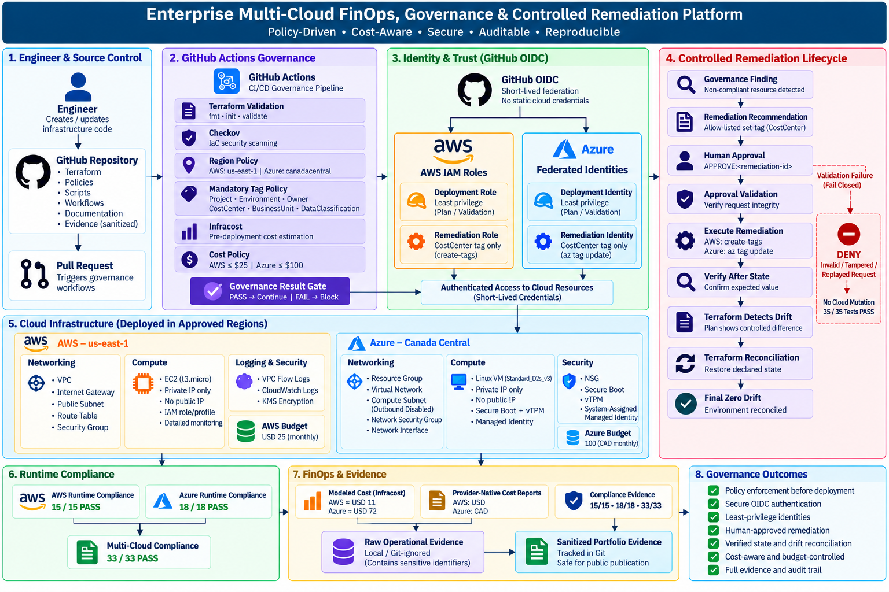

# Enterprise Multi-Cloud FinOps, Governance & Controlled Remediation Platform

A production-style multi-cloud platform demonstrating **FinOps, policy-as-code, secure CI/CD federation, runtime compliance, and human-approved controlled remediation across AWS and Azure**.

The platform moves cloud governance earlier into the engineering lifecycle while continuing to verify deployed infrastructure at runtime.

It demonstrates an end-to-end operating model:

```text
PLAN → VALIDATE → ESTIMATE → GOVERN → DEPLOY → VERIFY → REMEDIATE → RECONCILE → PROVE
```

---

## 1. Project Overview

Modern cloud environments require more than infrastructure provisioning.

Organizations also need to answer:

- Is infrastructure being deployed only into approved regions?
- Are mandatory ownership and cost-allocation tags present?
- What will a Terraform change cost before deployment?
- Can expensive infrastructure be blocked before creation?
- Are CI/CD pipelines using secure cloud authentication?
- Does deployed infrastructure remain compliant?
- Can governance violations be remediated safely?
- Does Terraform remain authoritative after remediation?
- Can the platform produce evidence without exposing sensitive cloud identifiers?

This project implements those controls across:

- AWS;
- Azure;
- Terraform;
- GitHub Actions;
- Checkov;
- Infracost;
- GitHub OIDC;
- AWS IAM;
- Microsoft Entra federation;
- Azure RBAC;
- provider-native cost management;
- custom governance automation.

---

## 2. Architecture



The platform follows this high-level flow:

```text
Engineer
   |
   v
GitHub Pull Request
   |
   v
PR Governance
   |
   +--> Terraform Validation
   +--> Checkov
   +--> Region Policy
   +--> Mandatory Tags
   +--> Infracost
   +--> Cost Policy
   |
   v
Governance Gate
   |
   v
GitHub OIDC
   |
   +--> AWS
   |
   +--> Azure
   |
   v
Runtime Compliance
   |
   v
Governance Finding
   |
   v
Recommendation
   |
   v
Human Approval
   |
   v
Controlled Remediation
   |
   v
Terraform Drift Detection
   |
   v
Terraform Reconciliation
   |
   v
Evidence
```

For the detailed architecture, see [Architecture](docs/architecture.md).

---

## 3. What This Project Demonstrates

The platform demonstrates several enterprise cloud-engineering capabilities.

### 3.1 Multi-Cloud Infrastructure as Code

AWS and Azure infrastructure are independently modeled using Terraform.

AWS includes:

- VPC;
- Internet Gateway;
- public subnet;
- route table;
- security groups;
- EC2;
- IAM role and instance profile;
- VPC Flow Logs;
- CloudWatch Logs;
- KMS encryption;
- AWS Budget.

Azure includes:

- Resource Group;
- Virtual Network;
- compute subnet;
- Network Security Group;
- Network Interface;
- Linux Virtual Machine;
- managed identity;
- Azure Consumption Budget.

---

### 3.2 Shift-Left Governance

Infrastructure changes are evaluated before deployment using:

- Terraform validation;
- Checkov;
- approved-region policy;
- mandatory-tag policy;
- Infracost;
- cost thresholds.

Invalid infrastructure is designed to fail before cloud mutation.

---

### 3.3 FinOps as an Engineering Control

Cost is evaluated throughout the infrastructure lifecycle.

The project implements:

- pre-deployment cost estimation;
- cloud-specific cost thresholds;
- AWS Budgets;
- Azure Consumption Budgets;
- provider-native cost reporting;
- multi-cloud cost evidence;
- cost-aware infrastructure teardown.

Validated modeled baseline:

| Cloud | Baseline          |   Modeled Monthly Cost |
| ----- | ----------------- | ---------------------: |
| AWS   | `t3.micro`        | approximately `USD 11` |
| Azure | `Standard_D2s_v3` | approximately `USD 72` |

Governance thresholds:

| Cloud | Threshold |
| ----- | --------: |
| AWS   |      `25` |
| Azure |     `100` |

Provider-native currencies are preserved rather than incorrectly combining values such as USD and CAD.

For details, see [FinOps](docs/finops.md).

---

## 4. Governance Model

The project implements governance as code.

Approved regions are:

| Cloud | Approved Region |
| ----- | --------------- |
| AWS   | `us-east-1`     |
| Azure | `canadacentral` |

Mandatory metadata includes:

- `Project`;
- `Environment`;
- `Owner`;
- `CostCenter`;
- `BusinessUnit`;
- `DataClassification`.

The repository also contains deliberately invalid Terraform examples proving that the controls reject:

- disallowed AWS regions;
- disallowed Azure regions;
- missing AWS tags;
- missing Azure tags;
- AWS cost-threshold violations;
- Azure cost-threshold violations.

For details, see [Governance](docs/governance.md).

---

## 5. Pull Request Governance

The primary CI/CD governance flow is implemented with GitHub Actions.

```text
Pull Request
     |
     v
Repository Safety
     |
     v
Terraform Static Validation
     |
     v
Checkov
     |
     v
Custom Governance
     |
     v
FinOps Policy
     |
     v
Governance Result
```

The project validated both:

- successful governance execution;
- intentional governance failure.

This proves that the pipeline acts as an enforcement gate rather than an informational report.

---

## 6. Secure Cloud Authentication With GitHub OIDC

GitHub Actions authenticates to AWS and Azure using OpenID Connect federation.

The CI/CD architecture does not require long-lived:

- AWS access keys;
- Azure client secrets.

Instead:

```text
GitHub Actions
      |
      v
GitHub OIDC
      |
   +--+--+
   |     |
   v     v
 AWS   Azure
 IAM   Federation
```

Cloud authorization remains controlled by:

- AWS IAM;
- Azure RBAC.

Deployment and remediation permissions are deliberately separated.

For details, see [Security](docs/security.md).

---

## 7. AWS Security Baseline

The AWS workload was validated with:

- approved region `us-east-1`;
- EC2 `t3.micro`;
- private IP addressing;
- no public IP;
- IAM instance role/profile;
- dedicated compute security group;
- detailed monitoring;
- VPC Flow Logs;
- CloudWatch Logs;
- KMS-encrypted logging;
- AWS Budget.

The EC2 instance is located in a **public subnet but has no public IP**.

This distinction is intentional: subnet classification is based on routing, while workload exposure is based on the instance network configuration.

---

## 8. Azure Security Baseline

The Azure workload was validated with:

- approved region `canadacentral`;
- Linux VM `Standard_D2s_v3`;
- private IP addressing;
- no public IP;
- Network Security Group;
- explicit subnet association;
- default outbound access disabled;
- system-assigned managed identity;
- Secure Boot;
- vTPM;
- Azure Consumption Budget.

This provides an intentionally hardened Azure compute baseline for governance validation.

---

## 9. Runtime Compliance

Pre-deployment validation is complemented by runtime cloud verification.

Final validated results:

| Environment |           Result |
| ----------- | ---------------: |
| AWS         | **15 / 15 PASS** |
| Azure       | **18 / 18 PASS** |
| Multi-Cloud | **33 / 33 PASS** |

The compliance layer validates live provider state rather than relying only on Terraform configuration.

Sanitized evidence is available under:

`reports/compliance/`

---

## 10. Controlled Remediation

The project implements human-approved controlled remediation for governed `CostCenter` metadata.

The lifecycle is:

```text
Finding
   |
   v
Recommendation
   |
   v
Policy Validation
   |
   v
Human Approval
   |
   v
Approval Validation
   |
   v
OIDC Authentication
   |
   v
Dedicated Remediation Identity
   |
   v
Before-State Verification
   |
   v
Restricted Mutation
   |
   v
Post-Change Verification
```

The validated remediation transition was:

`Engineering` → `CC-PLATFORM`

AWS mutation:

`aws ec2 create-tags`

Azure mutation:

`az tag update`

Only the allow-listed `CostCenter` mutation is supported.

For details, see [Controlled Remediation](docs/remediation.md).

---

## 11. Human Approval and Fail-Closed Execution

A governance finding does not automatically authorize mutation.

The exact approval format is:

`APPROVE:<remediation-id>`

The approval validator checks the remediation request against its evidence before cloud execution.

Invalid, inconsistent, tampered, or replayed requests are denied.

The final negative-path test suite completed:

**35 / 35 PASS**

This consisted of:

- approval DENY tests: `9 / 9`;
- AWS execution DENY tests: `13 / 13`;
- Azure execution DENY tests: `13 / 13`.

Unauthorized cloud mutation invocations during DENY testing:

`0`

This demonstrates fail-closed remediation behavior.

---

## 12. Terraform Drift and Reconciliation

Controlled remediation intentionally modifies a Terraform-managed tag outside Terraform.

This creates drift:

```text
Terraform Desired State
CostCenter = Engineering
        |
        v
Approved Remediation
        |
        v
Cloud Runtime State
CostCenter = CC-PLATFORM
        |
        v
Terraform Detects Drift
        |
        v
Terraform Reconciliation
        |
        v
CostCenter = Engineering
        |
        v
Zero Drift
```

This is an important architectural decision.

The remediation engine does not become a competing configuration-management authority.

**Terraform remains the source of truth.**

---

## 13. Evidence and Auditability

The project produces machine-readable evidence for:

- modeled cloud cost;
- provider-native cost;
- AWS runtime compliance;
- Azure runtime compliance;
- multi-cloud compliance;
- AWS remediation;
- Azure remediation;
- cross-cloud remediation;
- DENY-path testing.

The evidence model separates:

```text
Raw Operational Evidence
        |
        v
Sanitization
        |
        v
Curated Portfolio Evidence
```

Raw operational reports remain local or Git-ignored where appropriate.

Only sanitized evidence suitable for public publication is tracked.

---

## 14. Key Results

| Capability                               | Result           |
| ---------------------------------------- | ---------------- |
| AWS runtime compliance                   | **15 / 15 PASS** |
| Azure runtime compliance                 | **18 / 18 PASS** |
| Multi-cloud compliance                   | **33 / 33 PASS** |
| Approval DENY tests                      | **9 / 9 PASS**   |
| AWS execution DENY tests                 | **13 / 13 PASS** |
| Azure execution DENY tests               | **13 / 13 PASS** |
| Total remediation DENY tests             | **35 / 35 PASS** |
| Unauthorized mutations during DENY tests | **0**            |
| AWS controlled remediation               | **PASS**         |
| Azure controlled remediation             | **PASS**         |
| Terraform reconciliation                 | **Zero Drift**   |
| Static cloud credentials in CI/CD        | **None**         |

---

## 15. Technology Stack

| Area                   | Technologies                                         |
| ---------------------- | ---------------------------------------------------- |
| Cloud                  | AWS, Microsoft Azure                                 |
| Infrastructure as Code | Terraform                                            |
| CI/CD                  | GitHub Actions                                       |
| Cloud Authentication   | GitHub OIDC                                          |
| AWS Authorization      | IAM                                                  |
| Azure Identity         | Microsoft Entra ID                                   |
| Azure Authorization    | RBAC                                                 |
| IaC Security           | Checkov                                              |
| FinOps                 | Infracost                                            |
| AWS Cost Management    | AWS Budgets, provider-native cost APIs               |
| Azure Cost Management  | Azure Consumption Budgets, provider-native cost APIs |
| Governance Automation  | Bash, JSON, Terraform                                |
| Evidence Processing    | Bash, `jq`, JSON                                     |
| Version Control        | Git, GitHub                                          |

---

## 16. Repository Structure

```text
.
├── docs/
│   ├── adr/
│   ├── images/
│   ├── architecture.md
│   ├── finops.md
│   ├── governance.md
│   ├── implementation.md
│   ├── project-charter.md
│   ├── remediation.md
│   ├── security.md
│   └── troubleshooting.md
├── examples/
│   ├── compliant/
│   └── violations/
├── policies/
├── reports/
│   ├── compliance/
│   ├── cost/
│   └── remediation/
├── scripts/
│   ├── aws/
│   ├── azure/
│   ├── compliance/
│   ├── cost/
│   └── remediation/
├── terraform/
│   ├── aws/
│   │   ├── bootstrap/
│   │   ├── environments/
│   │   └── modules/
│   └── azure/
│       ├── bootstrap/
│       ├── environments/
│       └── modules/
├── infracost.yml
└── README.md
```

---

## 17. Documentation

Detailed project documentation is available here:

- [Project Charter](docs/project-charter.md)
- [Architecture](docs/architecture.md)
- [Implementation](docs/implementation.md)
- [FinOps](docs/finops.md)
- [Governance](docs/governance.md)
- [Security](docs/security.md)
- [Controlled Remediation](docs/remediation.md)
- [Troubleshooting](docs/troubleshooting.md)
- [Architecture Decision Records](docs/adr/README.md)

---

## 18. Evidence

### Compliance

- [AWS Compliance Evidence](reports/compliance/aws/aws-compliance-evidence.json)
- [Azure Compliance Evidence](reports/compliance/azure/azure-compliance-evidence.json)
- [Multi-Cloud Compliance Evidence](reports/compliance/summary/multicloud-compliance-evidence.json)

### Cost

- [AWS Cost Summary](reports/cost/aws/aws-cost-2026-09-01.summary.json)
- [Azure Cost Summary](reports/cost/azure/azure-cost-2026-09-01.summary.json)
- [Multi-Cloud Cost Summary](reports/cost/summary/multicloud-cost-2026-09-01.json)
- [Modeled Cost Baseline](reports/cost/summary/multicloud-cost-baseline.json)

### Controlled Remediation

- [AWS Execution Evidence](reports/remediation/aws/execution-evidence.json)
- [Azure Execution Evidence](reports/remediation/azure/execution-evidence.json)
- [Cross-Cloud Remediation Summary](reports/remediation/cross-cloud-remediation-summary.json)
- [DENY Test Summary](reports/remediation/deny-test-summary.json)

---

## 19. Engineering Decisions

Several architectural decisions were deliberately made to model enterprise operating practices.

### Separate Bootstrap and Workload State

Bootstrap infrastructure has a different lifecycle from workload infrastructure.

### OIDC Instead of Static Credentials

GitHub-to-cloud authentication uses short-lived federation.

### Separate Deployment and Remediation Identities

Different workflow responsibilities receive different permissions.

### Provider-Specific Infrastructure, Common Governance

AWS and Azure retain their native architectures while sharing organizational policy intent.

### Shift Governance Left

Policy and FinOps controls execute before deployment where possible.

### Human-Approved Remediation

Detection does not automatically authorize mutation.

### Fail Closed

Invalid remediation requests are denied rather than interpreted.

### Terraform Remains Authoritative

Out-of-band remediation is detected and reconciled through Infrastructure as Code.

### Preserve Native Billing Currencies

Cross-cloud financial data is not combined without explicit currency normalization.

### Sanitize Public Evidence

Operational proof is preserved without publishing unnecessary sensitive identifiers.

For the complete decision record, see [Architecture Decision Records](docs/adr/README.md).

---

## 20. Infrastructure Lifecycle

The workload infrastructure was intentionally ephemeral.

```text
Provision
   |
   v
Validate
   |
   v
Run Governance
   |
   v
Collect Evidence
   |
   v
Test Remediation
   |
   v
Reconcile Drift
   |
   v
Destroy
```

After final validation and evidence collection:

- AWS workload infrastructure was destroyed;
- Azure workload infrastructure was destroyed;
- workload Terraform state was verified;
- unnecessary recurring compute cost was eliminated.

Bootstrap and state infrastructure are managed separately.

---

## 21. Project Outcome

This project demonstrates an enterprise-style multi-cloud operating model in which infrastructure is not merely provisioned—it is continuously evaluated against **security, governance, financial, and operational controls**.

The completed platform demonstrates:

- multi-cloud Terraform engineering;
- policy-as-code;
- shift-left governance;
- Infrastructure-as-Code security scanning;
- pre-deployment FinOps;
- provider-native cost management;
- GitHub OIDC federation;
- least-privilege identity separation;
- runtime cloud compliance;
- human-approved remediation;
- fail-closed automation;
- Terraform drift detection and reconciliation;
- sanitized evidence publication;
- cost-aware infrastructure lifecycle management.

The result is a reproducible platform demonstrating how **DevOps, Platform Engineering, DevSecOps, FinOps, and Cloud Governance** can operate as one integrated engineering system.
