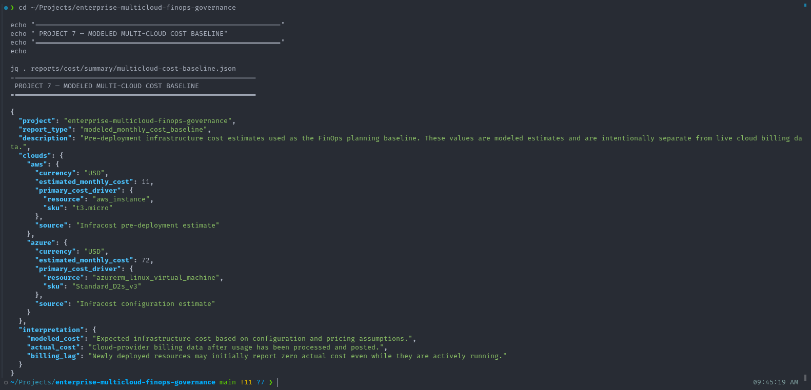
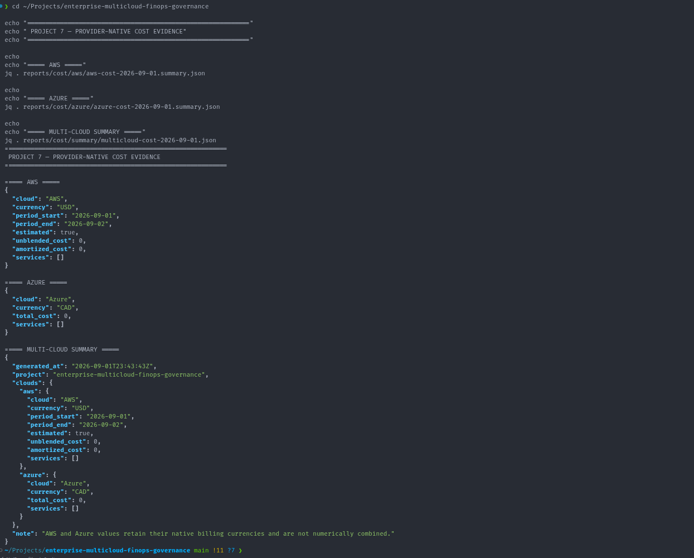

# FinOps

## 1. Overview

This document explains the FinOps design of the Enterprise Multi-Cloud FinOps, Governance & Controlled Remediation Platform.

The FinOps implementation combines:

- pre-deployment cost estimation;
- policy-based cost thresholds;
- provider-native cloud budgets;
- AWS cost reporting;
- Azure cost reporting;
- multi-cloud cost summaries;
- evidence publication;
- cost-aware infrastructure teardown.

The project treats FinOps as an engineering control rather than only as a billing-reporting activity.

The implementation addresses cost across three stages:

1. before deployment;
2. during runtime;
3. after validation.

---

## 2. FinOps Objectives

The primary FinOps objectives are:

- estimate infrastructure cost before deployment;
- detect cost increases before infrastructure is created;
- block configurations that exceed approved thresholds;
- use native AWS and Azure budget controls;
- collect provider-native billing information;
- preserve cloud-specific billing currencies;
- generate multi-cloud cost summaries;
- retain sanitized cost evidence;
- avoid unnecessary ongoing infrastructure cost after validation.

The project therefore applies FinOps principles throughout the infrastructure lifecycle.

---

## 3. FinOps Architecture

The cost-governance model is:

```text
Terraform Configuration
        |
        v
Infracost
        |
        v
Modeled Monthly Cost
        |
        v
Cost Policy
        |
   +----+----+
   |         |
Below      Above
Threshold  Threshold
   |         |
   v         v
 PASS       FAIL
   |
   v
Deployment / Runtime
   |
   v
Provider-Native Cost Data
   |
   v
AWS + Azure Cost Reports
   |
   v
Multi-Cloud Summary
   |
   v
Curated Evidence
```
This design separates cost estimation from actual billing.

---

## 4. Modeled Cost vs Actual Cost

A core design decision is to distinguish between modeled cost and provider-native billing.

### 4.1 Modeled Cost

Modeled cost is calculated before deployment using Infracost.

It answers questions such as:

- how much is this Terraform configuration expected to cost;
- which resources are responsible for the estimated cost;
- whether a proposed change exceeds a governance threshold.

Modeled cost is useful during pull requests and planning.

### 4.2 Actual Provider Cost

Actual cost comes from the cloud provider billing systems.

AWS and Azure billing data reflects:

- actual resource usage;
- billing-period timing;
- provider pricing;
- credits or discounts;
- billing-data availability.

Actual cost can lag behind infrastructure deployment.

The project therefore does not assume that zero provider-reported cost immediately after deployment means the infrastructure had no cost.

---

## 5. Infracost Implementation

Infracost is used for pre-deployment cost modeling.

The repository contains:

`infracost.yml`

This configuration allows both AWS and Azure Terraform environments to be evaluated through a centralized cost-governance process.

The validated baseline estimates were approximately:

AWS: `USD 11 / month`;
Azure: `USD 72 / month`.

These estimates represent modeled infrastructure cost.

They do not represent finalized provider invoices.

---

## 6. AWS Modeled Cost Baseline

The AWS modeled baseline uses:

`t3.micro`

as the primary compute cost driver.

The validated modeled monthly cost was approximately:

`USD 11`

This baseline provides a reference point for evaluating future Terraform changes.

If additional resources or larger instance types increase the estimated cost significantly, the governance layer can detect that before deployment.

---

# 7. Azure Modeled Cost Baseline

The Azure modeled baseline uses:

`Standard_D2s_v3`

as the primary compute SKU.

The validated modeled monthly cost was approximately:

`USD 72`

This value is an Infracost planning estimate.

It is intentionally kept separate from provider-native Azure billing evidence.

---

## 8. Cost Governance Thresholds

The project defines cost-policy thresholds for each cloud.

The configured thresholds are:

AWS: `25`;
Azure: `100`.

These thresholds represent governance limits rather than exact expected bills.

The evaluation is:
```text
Estimated Monthly Cost
        |
        v
Configured Threshold
        |
   +----+----+
   |         |
Within      Exceeds
Limit       Limit
   |         |
   v         v
 PASS       FAIL
```
The purpose is to prevent unexpectedly expensive infrastructure from passing governance unnoticed.

---

## 9. AWS Cost Threshold

The AWS governance threshold is:

`25`

The modeled AWS baseline was approximately:

`USD 11`

Therefore, the compliant baseline remains below the configured threshold.

A deliberately more expensive fixture is maintained under:

`examples/violations/aws-cost-threshold-exceeded/`

This fixture proves that the governance control can fail when projected cost exceeds the approved threshold.

---

## 10. Azure Cost Threshold

The Azure governance threshold is:

`100`

The modeled Azure baseline was approximately:

`USD 72`

Therefore, the compliant baseline remains below the configured threshold.

A cost-violation fixture is maintained under:

`examples/violations/azure-cost-threshold-exceeded/`

This proves the Azure cost policy can also reject a non-compliant infrastructure configuration.

---

## 11. Cost Policy Script

Cost-policy evaluation is implemented using:

`scripts/cost/check-cost-policy.sh`

The script evaluates modeled cost against the configured cloud-specific threshold.

The expected behavior is:

- compliant cost -> PASS;
- excessive cost -> FAIL.

This logic is suitable for CI/CD because it produces an explicit governance outcome.

---

## 12. Multi-Cloud Cost Configuration

The project uses:

`infracost.yml`

to centralize cost-estimation targets.

This allows the governance pipeline to evaluate both cloud environments as part of the same project without combining the underlying cloud architectures.

The design maintains:

- AWS-specific Terraform;
- Azure-specific Terraform;
- centralized FinOps orchestration.

---

## 13.  PR Cost Governance

Cost estimation is integrated into CI/CD governance.

The conceptual PR flow is:
```text
Pull Request
     |
     v
Terraform Change
     |
     v
Infracost
     |
     v
Cost Estimate
     |
     v
Cost Threshold Check
     |
 +---+---+
 |       |
PASS    FAIL
```
This shifts cost awareness earlier in the development lifecycle.

Instead of discovering an expensive change after deployment, the platform can identify the issue before merge.

---

## 14. Resolved Cost Governance

Some Terraform values may only become known after provider-aware planning.

The Resolved Cost Governance workflow therefore performs cloud-authenticated planning using GitHub OIDC.

The flow is:
```text
GitHub Actions
      |
      v
OIDC Federation
      |
 +----+----+
 |         |
 v         v
AWS       Azure
 |         |
 v         v
Resolved Terraform Plans
      |
      v
Infracost
      |
      v
Cost Policy
      |
      v
Governance Result
```
This improves the quality of cost evaluation when provider-resolved values are required.

The workflow is planning-oriented and does not automatically apply infrastructure changes.

---

## 15. AWS Native Budget

Terraform provisions an AWS Budget as part of the AWS baseline.

The configured monthly budget is:

`USD 25`

This provides a provider-native FinOps control.

The AWS budget complements Infracost.

The two controls solve different problems:

- Infracost estimates cost before deployment;
- AWS Budgets monitors cloud billing after deployment.

---

## 16.  Azure Native Budget

Terraform also provisions an Azure Consumption Budget.

The configured threshold is:

`100`

The budget is scoped to the project Resource Group.

This provides a native Azure cost-management control that complements pre-deployment estimation.

---

## 17. Modeled Cost and Native Budgets Are Complementary

The project intentionally uses both modeled cost and cloud-native budget controls.

The relationship is:
```text
Before Deployment
      |
      v
Infracost
      |
      v
Cost Governance

After Deployment
      |
      v
AWS / Azure Billing
      |
      v
Native Budgets
```
This provides cost controls before and after infrastructure deployment.

---

## 18. AWS Cost Reporting

AWS provider-native cost reporting is generated using:

`scripts/aws/generate-cost-report.sh`

The report is derived from AWS billing and cost-management APIs.

The report includes provider-native AWS cost information for the configured billing period.

Raw reports can contain operational metadata and therefore are not automatically considered safe for public repository publication.

---

## 19. Azure Cost Reporting

Azure provider-native cost reporting is generated using:

`scripts/azure/generate-cost-report.sh`

The report uses Azure cost-management information for the project scope.

As with AWS, raw reports are treated as operational artifacts.

They can contain identifiers or metadata that should not be committed publicly without review.

---

## 20. Multi-Cloud Cost Summary

Multi-cloud cost summarization is generated using:

`scripts/cost/generate-multicloud-summary.sh`

The summary provides centralized visibility into AWS and Azure cost information.

The implementation intentionally does not calculate a misleading combined total when the provider-native values use different currencies.

Instead, the summary retains cloud-specific values.

---

## 21. Currency Handling

One of the most important FinOps design decisions is preserving native currencies.

AWS cost evidence uses:

`USD`

Azure provider-native billing evidence can use:

`CAD`

The platform does not directly add:

`USD + CAD`

and present that value as a meaningful multi-cloud total.

A valid multi-cloud total would require an explicit currency-normalization strategy using an exchange rate and a defined conversion timestamp.

That conversion is outside the current project scope.

The project therefore preserves currency integrity rather than presenting false precision.

---

## 22. Modeled Azure Cost vs Native Azure Billing

The modeled Azure cost baseline from Infracost is expressed in:

`USD`

Provider-native Azure billing evidence is retained in its native billing currency.

This means these two values answer different questions.

The modeled value answers:

- what is this Terraform configuration expected to cost.

The provider-native value answers:

- what has Azure reported as billable consumption for the period.

The project intentionally does not treat them as interchangeable measurements.

---

## 23. Billing Lag

Cloud billing data is not always available immediately after resource creation.

During project validation, provider-native cost evidence could legitimately show:

`0`

for a very recent billing period.

This can occur because:

- billing ingestion is delayed;
- usage records have not yet been finalized;
- provider cost APIs have not yet published the latest consumption.

Therefore, provider-native zero-cost evidence is interpreted in context.

It does not invalidate the modeled infrastructure cost.

---

## 24. Cost Evidence

Cost evidence is stored under:

`reports/cost/`

The structure includes:

- AWS reports;
- Azure reports;
- multi-cloud summaries.

Curated cost evidence includes files such as:

`reports/cost/aws/aws-cost-2026-09-01.summary.json`

`reports/cost/azure/azure-cost-2026-09-01.summary.json`

`reports/cost/summary/multicloud-cost-2026-09-01.json`

`reports/cost/summary/multicloud-cost-baseline.json`

These files provide machine-readable evidence of the FinOps implementation.

---

## 25. Modeled Cost Baseline Evidence



*Infracost-derived modeled baseline showing the pre-deployment AWS and Azure cost estimates used by the FinOps governance layer.*

The modeled cost baseline evidence is maintained in:

`reports/cost/summary/multicloud-cost-baseline.json`

The validated values include approximately:

- AWS `t3.micro`: `USD 11`;
- Azure `Standard_D2s_v3`: `USD 72`.

This provides a stable portfolio reference for expected infrastructure cost.

---

## 26. Provider-Native Cost Evidence



*Provider-native cost evidence preserves AWS billing in USD and Azure billing in CAD rather than incorrectly aggregating different currencies.*

Provider-native cost evidence is maintained as sanitized summaries.

AWS summary:

`reports/cost/aws/aws-cost-2026-09-01.summary.json`

Azure summary:

`reports/cost/azure/azure-cost-2026-09-01.summary.json`

These are intentionally separate from raw operational cost files.

---

## 27. Multi-Cloud Cost Evidence

The multi-cloud summary is maintained in:

`reports/cost/summary/multicloud-cost-2026-09-01.json`

The summary provides a common view while retaining cloud-specific cost and currency information.

This allows centralized reporting without corrupting the underlying financial meaning.

---

## 28. Raw Cost Reports

Raw provider reports can include operational metadata that is unsuitable for public publication.

Examples can include:

- account identifiers;
- subscription identifiers;
- scope identifiers;
- resource identifiers;
- billing metadata.

Raw reports therefore remain local or Git-ignored where appropriate.

This preserves operational evidence without exposing unnecessary cloud details.

---

## 29. Curated Cost Evidence

Curated evidence is intentionally sanitized before being tracked in Git.

The publication model is:
```text
Cloud Billing APIs
        |
        v
Raw Operational Cost Report
        |
        v
Review / Sanitization
        |
        v
Curated Cost Summary
        |
        v
Git Repository
```
This allows the portfolio to demonstrate real cost-governance output safely.

---

## 30. FinOps Violation Fixtures

The repository includes deliberately non-compliant cost examples.

AWS:

`examples/violations/aws-cost-threshold-exceeded/`

Azure:

`examples/violations/azure-cost-threshold-exceeded/`

These examples provide deterministic negative-path testing.

They demonstrate that cost governance is not just documentation.

The policies are executable and can reject infrastructure changes.

---

## 31. Cost Governance as Policy-as-Code

The project treats cost thresholds as policy.

This means cost governance can be:

- version controlled;
- reviewed;
- tested;
- executed in CI/CD;
- changed through source control.

The cost-policy logic therefore becomes part of the engineering workflow.

This is more reliable than depending only on manual review of cloud billing dashboards.

---

## 32. FinOps and Governance Integration

FinOps is integrated with the broader governance pipeline.

The overall flow is:
```text
Terraform
   |
   +--> Security Validation
   |
   +--> Region Governance
   |
   +--> Tag Governance
   |
   +--> Cost Estimation
             |
             v
       Cost Threshold
             |
             v
       Governance Gate
```
A Terraform change is not considered compliant solely because it is technically valid.

It must also satisfy organizational cost controls.

---

## 33. FinOps and Mandatory Tags

Mandatory tagging directly supports FinOps.

The required metadata includes:

- `Project`;
- `Environment`;
- `Owner`;
- `CostCenter`;
- `BusinessUnit`.

These fields allow cloud spend to be associated with business and technical ownership.

The `CostCenter` tag is especially important because it is also used in the controlled-remediation use case.

---

## 34. CostCenter Governance

The project treats:

`CostCenter`

as both:

- a cost-allocation control;
- a remediation control.

This demonstrates how FinOps metadata can become an enforceable governance requirement rather than an optional labeling convention.

If the governed CostCenter state is incorrect, the platform can:

- detect the condition;
- recommend a supported remediation;
- require human approval;
- execute a controlled tag mutation;
- verify the new state;
- expose resulting Terraform drift.

---

## 35. Controlled Remediation and FinOps

The remediation implementation demonstrates a practical FinOps governance use case.

The validated transition was:

`Engineering` -> `CC-PLATFORM`

The mutation was intentionally restricted to the CostCenter tag.

AWS used:

`aws ec2 create-tags`

Azure used:

`az tag update`

The workflow did not allow arbitrary infrastructure modification.

This demonstrates controlled correction of financial-governance metadata.

---

## 36. Terraform Authority After FinOps Remediation

Because CostCenter is managed through Terraform, out-of-band remediation creates drift.

The lifecycle is:
```text
Terraform Desired Tag
        |
        v
CostCenter = Engineering
        |
        v
Approved FinOps Remediation
        |
        v
CostCenter = CC-PLATFORM
        |
        v
Terraform Detects Drift
        |
        v
Terraform Reconciliation
        |
        v
CostCenter = Engineering
```
This demonstrates that the remediation engine does not silently replace Terraform as the authoritative configuration source.

---

## 37. FinOps Evidence and Auditability

The platform generates evidence that can support engineering review and audit discussions.

Evidence can answer questions such as:

- what was the modeled infrastructure cost;
- what thresholds were configured;
- which cloud budgets existed;
- what cost data was reported;
- whether cost-policy tests passed;
- whether remediation changed cost-allocation metadata;
- whether the infrastructure was subsequently reconciled.

This makes FinOps decisions observable and reproducible.

---

## 38. Cost-Aware Infrastructure Lifecycle

The project intentionally destroys workload infrastructure after implementation and evidence collection are complete.

The lifecycle is:
```text
Provision
   |
   v
Validate
   |
   v
Measure Cost
   |
   v
Collect Evidence
   |
   v
Destroy
```
Keeping portfolio infrastructure running continuously would create cost without providing additional project value.

The teardown itself is therefore part of the FinOps operating model.

---

## 39. Workload Teardown

After final runtime validation:

- AWS workload infrastructure was destroyed;
- Azure workload infrastructure was destroyed;
- Terraform environment states were confirmed empty.

This prevented unnecessary recurring compute charges.

The project retained its source code, governance logic, evidence, and documentation independently of running cloud resources.

---

## 40. FinOps Design Principles

The project follows several FinOps principles.

### 40.1 Shift Cost Left

Infrastructure cost is evaluated before deployment using Infracost.

### 40.2 Use Guardrails

Cost thresholds can block infrastructure changes that exceed approved limits.

### 40.3 Use Native Cloud Controls

AWS Budgets and Azure Consumption Budgets provide provider-native post-deployment controls.

### 40.4 Preserve Financial Context

Different currencies are not combined without normalization.

### 40.5 Treat Tags as Financial Metadata

Mandatory ownership and cost-allocation tags support accountable cloud spending.

### 40.6 Make FinOps Evidence Reproducible

Cost reports and governance results are stored as machine-readable evidence.

### 40.7 Remove Idle Infrastructure

Validated portfolio infrastructure is destroyed when it is no longer needed.

---

## 41. FinOps Outcome

The final FinOps implementation combines:

- Infracost;
- Terraform;
- AWS Budgets;
- Azure Consumption Budgets;
- custom cost-policy enforcement;
- provider-native cost reporting;
- multi-cloud summaries;
- mandatory cost-allocation tags;
- controlled CostCenter remediation;
- evidence sanitization;
- infrastructure teardown.

The resulting lifecycle is:
```text
ESTIMATE
   |
   v
EVALUATE
   |
   v
ENFORCE
   |
   v
DEPLOY
   |
   v
MEASURE
   |
   v
REPORT
   |
   v
REMEDIATE
   |
   v
OPTIMIZE
   |
   v
REMOVE WHEN NO LONGER NEEDED
```
