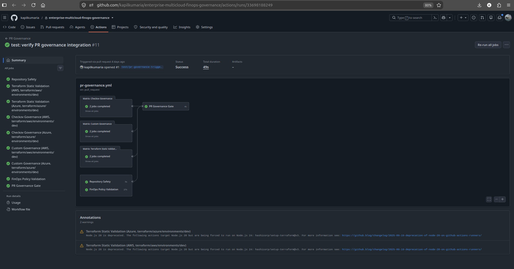
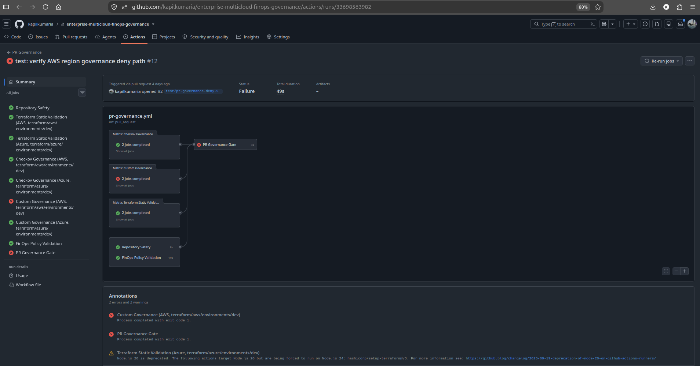
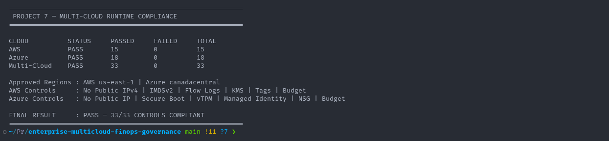

# Governance

## 1. Overview

This document explains the governance model implemented by the Enterprise Multi-Cloud FinOps, Governance & Controlled Remediation Platform.

The project combines:

- Terraform validation;
- Checkov;
- approved-region policies;
- mandatory tag policies;
- cost-governance thresholds;
- pull-request enforcement;
- runtime compliance validation;
- controlled remediation;
- evidence generation.

The platform treats governance as a lifecycle rather than a single policy engine.

The governance model is designed to answer four questions:

1. Is the proposed infrastructure technically valid?
2. Does it satisfy organizational policy?
3. Does the deployed infrastructure remain compliant?
4. Can approved violations be remediated safely?

---

## 2. Governance Objectives

The primary governance objectives are:

- enforce approved cloud regions;
- require mandatory metadata;
- prevent infrastructure changes that exceed cost guardrails;
- validate infrastructure security and configuration;
- enforce governance in CI/CD;
- detect runtime non-compliance;
- maintain machine-readable evidence;
- prevent unauthorized remediation;
- keep Terraform authoritative.

The implementation provides controls at both pre-deployment and runtime stages.

---

## 3. Governance Architecture

The governance lifecycle is:

```text
Infrastructure Change
        |
        v
Terraform Validation
        |
        v
Static Analysis
        |
        v
Custom Policy Checks
        |
        v
FinOps Evaluation
        |
        v
Governance Gate
        |
   +----+----+
   |         |
 PASS       FAIL
   |         |
   v         v
Runtime     Block
   |
   v
Compliance Validation
   |
   v
Finding
   |
   v
Controlled Remediation
```
This layered model avoids relying on a single governance mechanism.

---

## 4. Governance Layers

The project implements several independent governance layers.

4.1 Terraform Validation

Terraform validation establishes that the Infrastructure-as-Code configuration is syntactically and structurally valid.

This includes:

- formatting;
- initialization;
- provider resolution;
- configuration validation;
- planning.

Terraform validation is necessary but does not prove organizational compliance.

### 4.2 Checkov

Checkov provides static Infrastructure-as-Code security and configuration analysis.

It helps identify cloud security and configuration issues before deployment.

### 4.3 Custom Region Policy

Custom governance logic ensures that infrastructure uses approved cloud regions.

### 4.4 Mandatory Tag Policy

Custom validation ensures that required governance metadata is present.

#### 4.5 Cost Policy

Infracost and cost-policy logic evaluate projected infrastructure cost.

### 4.6 Runtime Compliance

Cloud APIs are queried after deployment to verify that the live infrastructure still satisfies governance requirements.

### 4.7 Controlled Remediation

Supported violations can enter a human-approved remediation workflow.

---

## 5. Approved Region Policy

The approved regions are:

- AWS: `us-east-1`;
- Azure: `canadacentral`.

The platform rejects infrastructure targeting other regions.

This provides:

- deployment consistency;
- policy enforcement;
- residency control;
- operational standardization;
- predictable cost and support boundaries.

---

## 6. AWS Region Governance

AWS infrastructure is expected to target:

`us-east-1`

Region validation is implemented using custom governance logic.

The repository includes a negative-path fixture:

`examples/violations/aws-disallowed-region/`

This fixture intentionally targets a non-approved AWS region.

The expected result is:

`FAIL`

This proves the control is executable rather than only documented.

---

## 7. Azure Region Governance

Azure infrastructure is expected to target:

`canadacentral`

The repository includes a negative-path fixture:

`examples/violations/azure-disallowed-region/`

The expected result is:

`FAIL`

This proves the same governance concept across Azure.

---

## 8. Mandatory Tag Policy

The project requires standardized governance metadata.

Mandatory tags include:

- `Project`;
- `Environment`;
- `Owner`;
- `CostCenter`;
- `BusinessUnit`;
- `DataClassification`.

These tags support both operational governance and FinOps.

---

## 9. Purpose of Mandatory Tags

The required tags serve specific governance purposes.

### 9.1 Project

`Project`

Associates infrastructure with the owning project or platform.

### 9.2 Environment

`Environment`

Identifies the lifecycle environment such as development, staging, or production.

### 9.3 Owner

`Owner`

Establishes technical or organizational ownership.

### 9.4 CostCenter

`CostCenter`

Provides financial allocation metadata.

### 9.5 BusinessUnit

`BusinessUnit`

Maps resources to an organizational unit.

### 9.6 DataClassification

`DataClassification`

Provides security and governance context for the data associated with the workload.

---

## 10. Mandatory Tag Validation

Tag governance is implemented using:

`scripts/compliance/check-mandatory-tags.sh`

The validation checks Terraform configuration for the required governance keys.

The expected behavior is:
```text
Terraform Configuration
        |
        v
Required Tag Validation
        |
   +----+----+
   |         |
Complete   Missing
   |         |
   v         v
 PASS       FAIL
```
---

## 11. AWS Missing-Tag Fixture

The AWS missing-tag fixture is located at:

`examples/violations/aws-missing-required-tags/`

It intentionally removes required governance metadata.

The expected policy result is:

`FAIL`

This provides a repeatable negative-path test.

---

## 12. Azure Missing-Tag Fixture

The Azure missing-tag fixture is located at:

`examples/violations/azure-missing-required-tags/`

The expected result is:

`FAIL`

This proves equivalent tag-policy enforcement across Azure.

---

## 13. Cost Governance

Cost governance is treated as part of the broader governance model.

The project evaluates modeled infrastructure cost against configured thresholds.

The cost thresholds are:

AWS: `25`;
Azure: `100`.

Cost governance is implemented using:

`scripts/cost/check-cost-policy.sh`

---

## 14. AWS Cost Violation Fixture

The AWS cost-policy violation fixture is:

`examples/violations/aws-cost-threshold-exceeded/`

The fixture intentionally creates a projected cost above the approved threshold.

The expected result is:

`FAIL`

---

## 15. Azure Cost Violation Fixture

The Azure cost-policy violation fixture is:

`examples/violations/azure-cost-threshold-exceeded/`

The expected result is:

`FAIL`

This proves that FinOps guardrails participate directly in governance.

---

## 16. Checkov Governance

Checkov adds a static policy layer on top of Terraform validation.

The governance model is:

```text
Terraform
   |
   +--> Syntax / Validation
   |
   +--> Checkov Security Analysis
   |
   +--> Custom Governance
```
Checkov identifies classes of configuration risk that may not be covered by the project's custom controls.

This provides defense in depth.

---

## 17. Pre-Deployment Governance Orchestration

The project includes:

`scripts/compliance/run-predeployment-governance.sh`

This script coordinates major custom governance checks.

The orchestration includes:

- region policy;
- mandatory tag policy;
- cost policy.

The script provides a single governance entry point for CI/CD while keeping individual controls independently testable.

---

## 18. Pull Request Governance

The PR Governance workflow is the primary pre-merge governance gate.

The flow is:

```text
Pull Request
     |
     v
Repository Safety
     |
     v
Terraform Static Validation
     |
     v
Checkov
     |
     v
Custom Governance
     |
     v
FinOps Policy
     |
     v
Governance Result
```
A compliant change can proceed.

A non-compliant change fails the governance gate.

---

## 19. Repository Safety

Repository safety validation protects the public project repository from unsafe content.

Checks include conditions such as:

- sensitive cloud identifiers;
- static credentials;
- inappropriate operational evidence;
- invalid generated artifacts.

This provides a publication-safety layer in addition to infrastructure governance.

---

## 20. Terraform Static Governance

Terraform static validation is executed before cloud mutation.

The project validates:

- formatting;
- initialization;
- provider compatibility;
- configuration validity.

This prevents invalid Infrastructure-as-Code changes from progressing into higher governance stages.

---

## 21. Custom Governance Stage

Custom governance combines policies that are specific to the project.

Examples include:

- approved AWS region;
- approved Azure region;
- mandatory tags;
- cost thresholds.

These controls represent organization-specific requirements that are not necessarily covered by generic scanners.

---

## 22. Governance Result Gate

The governance workflow produces a final result.

Conceptually:

```text
All Governance Jobs
        |
        v
Result Aggregation
        |
   +----+----+
   |         |
 PASS       FAIL
```
The final result provides a single CI/CD decision based on several independent controls.

---

## 23. Positive and Negative Path Validation



*Compliant pull request successfully passing the multi-stage governance pipeline.*



*Intentional policy violation demonstrating that the governance pipeline fails closed and blocks a non-compliant change.*

A governance system is only useful if it can prove both outcomes.

The project validates:

- compliant changes pass;
- violations fail.

Historical GitHub Actions evidence includes both a successful and failing PR Governance run.

This demonstrates that the gate is active and not merely informational.

---

## 24. Resolved Cost Governance

Some Terraform cost calculations require provider-aware values.

The Resolved Cost Governance workflow authenticates to AWS and Azure using GitHub OIDC.

The flow is:

```text
GitHub Actions
      |
      v
OIDC Federation
      |
      v
Terraform Plan
      |
      v
Infracost
      |
      v
Cost Governance
      |
      v
Result
```
This allows cost policy to evaluate provider-resolved Terraform plans.

---

## 25. Governance and OIDC

Governance workflows use short-lived OIDC authentication where live cloud access is required.

This prevents governance automation from relying on long-lived cloud credentials.

Authentication and authorization remain separate.

OIDC proves workflow identity.

AWS IAM and Azure RBAC define permitted actions.

---

## 26. Runtime Governance

Pre-deployment policy cannot detect every possible runtime condition.

The project therefore includes live compliance scanning.

AWS runtime compliance is evaluated using:

`scripts/compliance/check-aws-compliance.sh`

Azure runtime compliance is evaluated using:

`scripts/compliance/check-azure-compliance.sh`

---

## 27. AWS Runtime Compliance

The AWS scanner validates the deployed environment against expected controls.

The final validated result was:

`15 / 15 PASS`

The runtime checks cover AWS-specific governance properties such as:

- approved region;
- expected compute configuration;
- required tags;
- networking controls;
- logging;
- encryption;
- budget configuration.

---

## 28. Azure Runtime Compliance

The Azure scanner validates the deployed Azure environment.

The final validated result was:

`18 / 18 PASS`

The runtime checks include Azure-specific controls such as:

- approved region;
- expected VM SKU;
- required tags;
- no public IP;
- subnet outbound configuration;
- NSG association;
- managed identity;
- Secure Boot;
- vTPM;
- budget configuration.

---

## 29. Multi-Cloud Compliance Aggregation



*Final runtime compliance evidence: AWS 15/15, Azure 18/18, and 33/33 controls compliant across both clouds.*

AWS and Azure results are aggregated into a centralized summary.

The final validated state was:

- AWS: `15 / 15 PASS`;
- Azure: `18 / 18 PASS`;
- Multi-cloud: `33 / 33 PASS`.

The model is:

```text
AWS Compliance
15 / 15
      \
       \
        +--> Multi-Cloud Compliance
       /          33 / 33
      /
Azure Compliance
18 / 18
```
This provides centralized reporting without hiding cloud-specific controls.

---

## 30. Runtime Findings

A governance finding represents a detected condition that may require remediation.

A finding can contain information such as:

- cloud;
- resource;
- policy;
- current value;
- expected value;
- remediation eligibility.

A finding does not automatically authorize mutation.

It becomes input to the controlled-remediation process.

---

## 31. Governance to Remediation Boundary

The transition from detection to remediation is intentionally controlled.

The lifecycle is:

```text
Governance Finding
        |
        v
Recommendation
        |
        v
Policy Validation
        |
        v
Human Approval
        |
        v
Execution
```
Detection alone does not trigger a cloud change.

This prevents governance automation from becoming unrestricted self-healing.

---

## 32. Remediation Policy

The remediation policy is maintained in:

`scripts/remediation/remediation-policy.json`

It defines which mutation classes are permitted.

The supported action is:

`set-tag`

The governed field is:

`CostCenter`

This creates a narrow allow-list.

---

## 33. Recommendation Engine

Remediation recommendations are generated using:

`scripts/remediation/generate-remediation-recommendation.sh`

The recommendation engine evaluates whether the requested remediation is allowed by policy.

The recommendation records the proposed action.

It does not authorize execution.

---

## 34. Human Approval Requirement

Controlled remediation requires explicit human approval.

The confirmation format is:

`APPROVE:<remediation-id>`

The exact token is validated before execution.

This creates an explicit human-in-the-loop control.

---

## 35. Approval Validation

Approval validation uses:

`scripts/remediation/validate-remediation-approval.sh`

The validator checks relevant remediation attributes before allowing execution.

Examples include:

- remediation ID;
- cloud;
- resource;
- action;
- tag key;
- current value;
- desired value;
- evidence;
- approval token.

A mismatch produces:

`DENY`

---

## 36. Fail-Closed Governance

The remediation architecture is designed to fail closed.

If validation cannot prove that an operation is authorized, the platform denies execution.

The expected behavior is:

```text
Invalid / Inconsistent Request
          |
          v
Validation Failure
          |
          v
DENY
          |
          v
No Cloud Mutation
```
This is a core governance property.

---

## 37. AWS Remediation Governance

AWS remediation is restricted to the approved tag mutation.

The permitted mutation class is:

`aws ec2 create-tags`

The executor validates the live before-state before mutation.

It also validates the post-change state after execution.

---

## 38. Azure Remediation Governance

Azure remediation is similarly restricted.

The permitted mutation class is:

`az tag update`

The operation is limited to the approved resource and governed CostCenter mutation.

Before-state and post-change verification are both required.

---

## 39. Terraform Remains Authoritative

Controlled remediation intentionally creates temporary drift when it changes a Terraform-managed tag.

Terraform then detects the change.

The lifecycle is:

```text
Terraform Desired State
        |
        v
Governed Cloud Resource
        |
        v
Approved Out-of-Band Remediation
        |
        v
Drift
        |
        v
Terraform Detection
        |
        v
Terraform Reconciliation
```
This prevents the remediation system from becoming a competing source of infrastructure truth.

---

## 40. Remediation DENY Testing

The platform includes dedicated negative-path testing.

The final DENY-path validation completed:

`35 / 35 PASS`

The tests confirmed:

- invalid approvals were denied;
- invalid executions were denied;
- cloud mutation commands were not invoked;
- cloud resource state remained unchanged.

This provides evidence that the remediation safety controls are effective.

---

## 41. Governance Evidence

Governance evidence is stored under:

`reports/`

Relevant evidence categories include:

- compliance;
- remediation;
- cost.

Governance evidence allows the project to demonstrate:

- policy results;
- compliance results;
- ALLOW paths;
- DENY paths;
- post-remediation verification.

---

## 42. Compliance Evidence

Sanitized compliance evidence includes:

`reports/compliance/aws/aws-compliance-evidence.json`

`reports/compliance/azure/azure-compliance-evidence.json`

`reports/compliance/summary/multicloud-compliance-evidence.json`

These files provide machine-readable proof of runtime governance.

---

## 43. Remediation Evidence

Controlled remediation evidence includes:

`reports/remediation/aws/execution-evidence.json`

`reports/remediation/azure/execution-evidence.json`

`reports/remediation/cross-cloud-remediation-summary.json`

`reports/remediation/deny-test-summary.json`

This evidence demonstrates both successful controlled mutation and rejected unauthorized paths.

---

## 44. Evidence Sanitization

Raw governance evidence may contain sensitive operational metadata.

The repository therefore distinguishes:

- raw operational evidence;
- curated public evidence.

Curated evidence is reviewed and sanitized before being tracked in Git.

This protects sensitive cloud identifiers while preserving proof of implementation.

---

## 45. Governance Test Fixtures

The repository includes intentional policy violations.

Examples include:

- AWS disallowed region;
- Azure disallowed region;
- AWS missing tags;
- Azure missing tags;
- AWS excessive cost;
- Azure excessive cost;
- invalid remediation findings.

These fixtures are important because governance should be tested with expected failures.

---

## 46. Governance as Code

The project implements governance as code.

Policies and controls are:

- version controlled;
- reviewable;
- testable;
- executable;
- auditable.

This provides repeatability and reduces dependence on manual cloud-console review.

---

## 47. Governance and FinOps

Governance and FinOps are integrated.

A change can be technically correct but financially unacceptable.

The project therefore evaluates:

- technical validity;
- security posture;
- organizational metadata;
- projected cost.

All of these participate in the governance result.

---

## 48. Governance and Security

Governance also integrates with security.

Examples include:

- Checkov scanning;
- private workload addressing;
- logging and encryption;
- Azure Secure Boot;
- Azure vTPM;
- no static CI/CD cloud credentials;
- least-privilege remediation identities.

Governance therefore spans organizational, financial, operational, and security controls.

---

## 49. Governance and Auditability

The platform produces machine-readable results that support auditability.

The evidence can answer questions such as:

- which region was approved;
- whether required tags were present;
- whether cost thresholds passed;
- whether runtime compliance passed;
- whether remediation was approved;
- whether a cloud mutation occurred;
- whether an invalid request was denied;
- whether Terraform detected and reconciled drift.

This makes governance behavior observable.

---

## 50. Infrastructure Teardown as Governance

After implementation and validation were complete, the AWS and Azure workload environments were destroyed.

This was an intentional governance and FinOps action.

Long-running unused infrastructure would violate the project's cost-efficiency objectives.

The teardown confirmed that governance also includes lifecycle management.

---

## 51. Governance Design Principles

The project follows several governance principles.

### 51.1 Shift Governance Left

Policies execute before deployment where possible.

### 51.2 Layer Controls

Terraform validation, Checkov, custom policies, cost controls, runtime compliance, and remediation validation solve different problems.

### 51.3 Prove Failure Paths

Governance must demonstrate that invalid changes are actually blocked.

### 51.4 Separate Detection From Mutation

A finding does not automatically authorize remediation.

### 51.5 Require Human Approval

Cloud mutation requires explicit approval.

### 51.6 Fail Closed

Unverifiable or inconsistent requests are denied.

### 51.7 Preserve Infrastructure Authority

Terraform remains authoritative after remediation.

### 51.8 Publish Safe Evidence

Public evidence is sanitized before being committed.

---

## 52. Governance Outcome

The final governance implementation combines:

- Terraform validation;
- Checkov;
- region policy;
- mandatory tags;
- cost thresholds;
- pull-request enforcement;
- OIDC-authenticated governance workflows;
- runtime compliance;
- human-approved remediation;
- fail-closed validation;
- Terraform reconciliation;
- evidence publication.

The resulting lifecycle is:
```text
DEFINE
  |
  v
VALIDATE
  |
  v
ENFORCE
  |
  v
DEPLOY
  |
  v
VERIFY
  |
  v
DETECT
  |
  v
APPROVE
  |
  v
REMEDIATE
  |
  v
RECONCILE
  |
  v
PROVE
```
