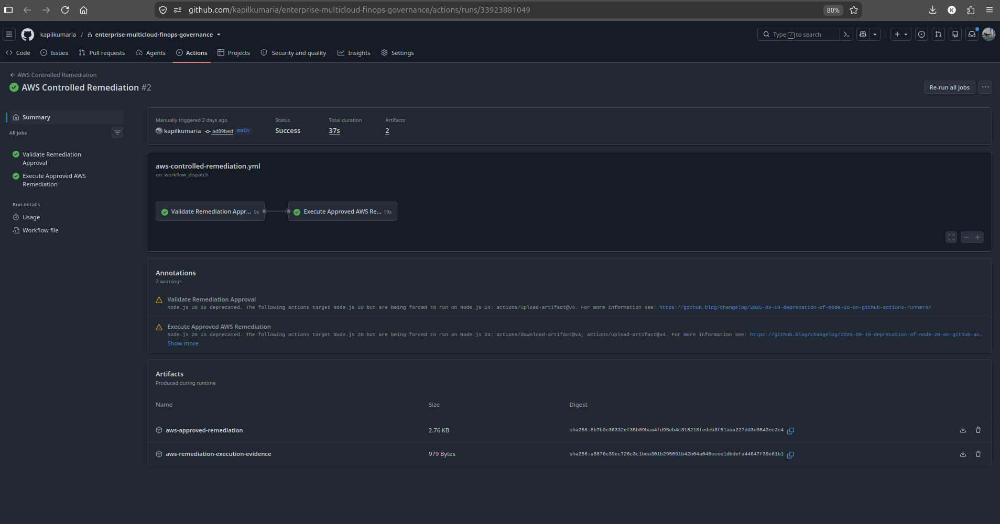
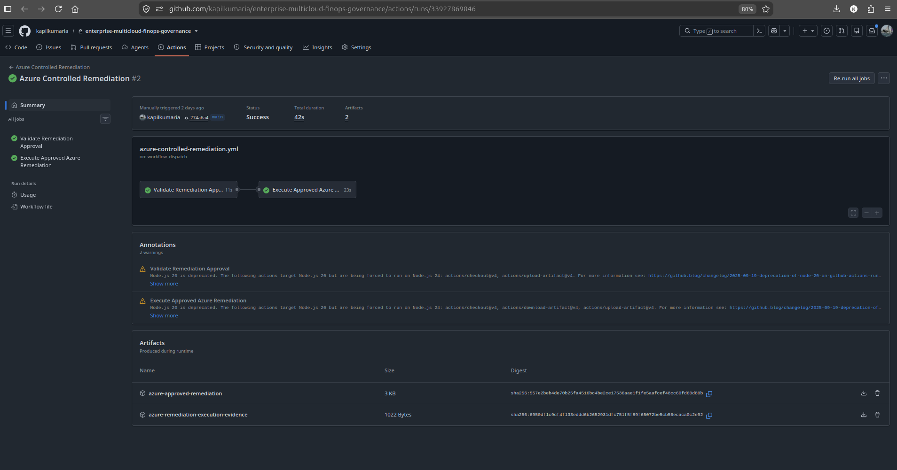

# Implementation

## 1. Overview

This document explains how the Enterprise Multi-Cloud FinOps, Governance & Controlled Remediation Platform was implemented across AWS and Microsoft Azure.

The platform was built incrementally so that each major capability could be validated before the next layer was introduced.

The implementation sequence followed this progression:

```text
Repository Foundation
        |
        v
Terraform Bootstrap
        |
        v
AWS Infrastructure
        |
        v
Azure Infrastructure
        |
        v
FinOps Controls
        |
        v
Policy Enforcement
        |
        v
Runtime Compliance
        |
        v
GitHub Actions Governance
        |
        v
OIDC Federation
        |
        v
Controlled Remediation
        |
        v
Evidence Publication
        |
        v
Final Validation
```
The project deliberately introduced controlled remediation only after infrastructure, governance, identity, cost controls, and runtime compliance had already been validated.

---

## 2. Repository Foundation

The repository was structured to separate infrastructure, governance logic, automation, evidence, examples, and documentation.

The major repository areas are:

- `.github/workflows/`;
- `terraform/`;
- `policies/`;
- `scripts/`;
- `examples/`;
- `reports/`;
- `docs/`;
- `diagrams/`.

The structure provides clear ownership boundaries.

- Terraform code remains isolated from runtime and governance scripts.
- Governance policies remain independent from infrastructure modules.
- Runtime evidence remains separate from implementation code.
- Test fixtures remain separate from compliant infrastructure.
- Documentation and architecture assets remain independently maintainable.

The repository foundation was created first so that every later capability had a predictable location and naming convention.

---

## 3. Terraform Bootstrap Architecture

AWS and Azure each use a dedicated Terraform bootstrap root.

The AWS bootstrap root is:

`terraform/aws/bootstrap/`

The Azure bootstrap root is:

`terraform/azure/bootstrap/`

The workload environment roots are:

`terraform/aws/environments/dev/`

`terraform/azure/environments/dev/`

The bootstrap layer establishes foundational resources required before the workload environments can be managed.

This design avoids circular dependencies where Terraform would otherwise depend on remote-state or CI/CD identity infrastructure that Terraform itself had not yet created.

The bootstrap and workload layers are intentionally separated so that foundational resources can be retained independently from workload infrastructure.

---

## 4. Terraform Module Architecture

Both cloud implementations use the same high-level modular structure.

### 4.1 AWS Modules

AWS modules include:

- networking;
- compute;
- budget.

The modules are located under:

`terraform/aws/modules/`

The AWS environment composes these modules from:

`terraform/aws/environments/dev/`

---

### 4.2 Azure Modules

Azure modules include:

- networking;
- compute;
- budget.

The modules are located under:

`terraform/azure/modules/`

The Azure environment composes these modules from:

`terraform/azure/environments/dev/`

This gives the project architectural consistency across clouds while preserving provider-specific implementation details.

---

## 5. AWS Infrastructure

The AWS baseline infrastructure was deployed in the approved region:

`us-east-1`

The AWS environment was implemented using Terraform modules for networking, compute, and budget governance.

### 5.1 AWS Networking

The AWS networking module provisions:

- VPC;
- Internet Gateway;
- public subnet;
- public route table;
- route-table association;
- managed default security group;
- compute security group;
- VPC Flow Logs;
- CloudWatch log group;
- KMS key and alias;
- IAM role and policy for VPC Flow Logs.

The conceptual network structure is:

```text
AWS / us-east-1
|
+-- VPC
    |
    +-- Internet Gateway
    |
    +-- Public Subnet
    |     |
    |     +-- EC2
    |
    +-- Public Route Table
    |
    +-- Compute Security Group
    |
    +-- VPC Flow Logs
          |
          +-- IAM Role
          |
          +-- CloudWatch Logs
                  |
                  +-- KMS Encryption
```

The EC2 workload resides in a subnet classified as public because the route table contains a route through an Internet Gateway.

However, the EC2 instance itself is configured with:

`associate_public_ip_address = false`

Therefore, the correct implementation description is:

- EC2 is deployed in a public subnet;
- EC2 receives a private IP address;
- EC2 does not receive a public IP address.

This distinction is important because subnet routing classification and instance-level public addressing are separate architectural properties.

### 5.2 AWS Compute

The AWS compute module provisions:

- EC2 instance;
- IAM role;
- IAM instance profile.

The baseline instance type is:

`t3.micro`

The machine image is resolved dynamically using AWS Systems Manager Parameter Store rather than hardcoding an AMI identifier.

Compute controls include:

- no public IP assignment;
- EC2 metadata configuration;
- detailed monitoring;
- security-group attachment;
- IAM role-based identity.

### 5.3 AWS Logging

VPC Flow Logs were enabled to provide network-level operational visibility.

The logging path is:
```text
VPC
 |
 v
VPC Flow Logs
 |
 v
CloudWatch Log Group
 |
 v
KMS Encryption
```
A dedicated IAM role allows the VPC Flow Logs service to publish log events.

The CloudWatch log group is protected using a dedicated KMS key.

This provides both operational visibility and encryption for network-flow evidence.

### 5.4 AWS Budget

The AWS budget module provisions a provider-native monthly budget.

The configured threshold is:

`USD 25`

This provides native AWS cost governance in addition to pre-deployment cost estimation.

---

## 6. Azure Infrastructure

The Azure baseline infrastructure was deployed in the approved region:

`canadacentral`

The Azure environment includes:

- Resource Group;
- Virtual Network;
- compute subnet;
- Network Security Group;
- subnet-to-NSG association;
- Network Interface;
- Linux Virtual Machine;
- Azure Consumption Budget.

### 6.1 Azure Networking

The Azure networking module provisions:

- Virtual Network;
- compute subnet;
- Network Security Group;
- subnet-to-NSG association.

The compute subnet explicitly disables Azure default outbound access using:

`default_outbound_access_enabled = false`

This prevents the workload from relying on implicit Azure outbound connectivity.

The VM does not use a public IP.

### 6.2 Azure Compute

The Azure compute module provisions:

- Network Interface;
- Linux Virtual Machine.

The baseline VM size is:

`Standard_D2s_v3`

Security controls include:

- private IP addressing;
- no public IP;
- Secure Boot;
- virtual TPM;
- system-assigned managed identity.

The implementation enables:

`secure_boot_enabled = true`

and:

`vtpm_enabled = true`

### 6.3 Azure Managed Identity

The Azure VM uses a system-assigned managed identity.

This provides Azure-native workload identity without embedding application credentials into the VM configuration.

The VM workload identity is separate from the GitHub Actions federated identities used for CI/CD.

### 6.4 Azure Budget

The Azure budget module provisions a Resource Group-scoped consumption budget.

The configured threshold is:

`100`

This provides provider-native Azure cost governance in addition to pre-deployment cost modeling.

---

## 7. Mandatory Tag Model

The project standardizes governance metadata across AWS and Azure.

Mandatory tags include:

- `Project`;
- `Environment`;
- `Owner`;
- `CostCenter`;
- `BusinessUnit`;
- `DataClassification`.

These tags support:

- cost allocation;
- ownership;
- accountability;
- environment classification;
- governance reporting;
- security classification.

The same governance concepts are enforced consistently across both cloud platforms.

---

## 8. Region Governance

The approved cloud regions are:

AWS: `us-east-1`;
Azure: `canadacentral`.

Custom governance logic validates Terraform configuration against these approved regions.

Violation fixtures are maintained under:

`examples/violations/aws-disallowed-region/`

and:

`examples/violations/azure-disallowed-region/`

These fixtures intentionally violate the approved-region policy.

The expected behavior is:

```text
Terraform Configuration
        |
        v
Region Policy
        |
   +----+----+
   |         |
Approved   Invalid
   |         |
   v         v
 PASS       FAIL
```
This proves that the governance layer can reject infrastructure targeting unsupported cloud regions.

---

## 9. Mandatory Tag Governance

Required-tag validation is implemented through custom governance scripts.

The platform checks Terraform configuration for the mandatory tag set before infrastructure changes are considered compliant.

Violation fixtures are maintained under:

`examples/violations/aws-missing-required-tags/`

and:

`examples/violations/azure-missing-required-tags/`

These fixtures make negative-path governance behavior reproducible rather than relying on accidental misconfiguration.

---

## 10. Checkov Integration

Checkov was integrated as a static Infrastructure-as-Code security and configuration scanner.

It complements Terraform validation and custom governance controls.

The pre-deployment governance model is:
```text
Terraform Validation
        |
        +
Checkov
        |
        +
Region Governance
        |
        +
Mandatory Tag Governance
        |
        +
Cost Governance
```
No individual tool is treated as sufficient on its own.

Each layer validates a different category of infrastructure risk.

---

## 11. Infracost Implementation

Infracost provides pre-deployment infrastructure cost estimation.

The project configuration is maintained in:

`infracost.yml`

Validated modeled monthly baselines were approximately:

AWS `t3.micro`: `USD 11`;

Azure `Standard_D2s_v3`: `USD 72`.

These values represent modeled infrastructure estimates.

They are not treated as provider invoices.

---

## 12. Cost Policy Enforcement

The project applies governance thresholds to modeled infrastructure cost.

The configured thresholds are:

AWS: `25`;

Azure: `100`.

Violation fixtures are maintained under:

`examples/violations/aws-cost-threshold-exceeded/`

and:

`examples/violations/azure-cost-threshold-exceeded/`

The cost-policy evaluation model is:
```text
Modeled Cost
     |
     v
Cost Threshold
     |
 +---+---+
 |       |
Below   Above
 |       |
 v       v
PASS    FAIL
```
This allows the governance pipeline to reject infrastructure that exceeds approved FinOps guardrails.

---

## 13. Pre-Deployment Governance Orchestration

The project includes a centralized governance orchestration script:

`scripts/compliance/run-predeployment-governance.sh`

The orchestration combines major custom controls including:

- approved-region validation;
- mandatory-tag validation;
- cost-policy validation.

This provides a single CI/CD entry point while preserving each individual policy script for independent execution and troubleshooting.

---

## 14. Provider-Native Cost Reporting

Provider-native cost reporting is implemented separately from Infracost.

AWS cost reporting uses:

`scripts/aws/generate-cost-report.sh`

Azure cost reporting uses:

`scripts/azure/generate-cost-report.sh`

Multi-cloud summarization uses:

`scripts/cost/generate-multicloud-summary.sh`

The project intentionally preserves native provider currencies.

It does not create an artificial total by directly adding AWS and Azure values denominated in different currencies.

---

## 15. Runtime Compliance

Pre-deployment governance does not prove that live cloud infrastructure remains compliant.

Runtime compliance scanners were therefore implemented for both cloud providers.

### 15.1 AWS Runtime Compliance

AWS runtime compliance is evaluated using:

`scripts/compliance/check-aws-compliance.sh`

The final validated result was:

`15 / 15 PASS`

15.2 Azure Runtime Compliance

Azure runtime compliance is evaluated using:

`scripts/compliance/check-azure-compliance.sh`

The final validated result was:

`18 / 18 PASS`

### 15.3 Multi-Cloud Compliance

The combined validated result was:

`33 / 33 PASS`

The aggregation model is:
```text
AWS Compliance
15 / 15
      \
       \
        +--> Multi-Cloud Compliance
       /          33 / 33
      /
Azure Compliance
18 / 18
```
This provides centralized governance visibility while preserving cloud-specific control logic.

---

## 16. GitHub Actions Governance

GitHub Actions provides the CI/CD governance control plane.

The repository contains dedicated workflows for:

- PR Governance;
- Resolved Cost Governance;
- AWS OIDC Validation;
- Azure OIDC Validation;
- AWS Remediation OIDC Validation;
- Azure Remediation OIDC Validation;
- Controlled Remediation Approval;
- AWS Controlled Remediation;
- Azure Controlled Remediation.

The workflows are separated by responsibility to reduce permission scope and improve auditability.

---

## 17. Pull Request Governance

The PR Governance workflow evaluates proposed infrastructure changes.

Its major validation areas include:

- repository safety;
- Terraform static validation;
- Checkov;
- custom governance;
- FinOps policy;
- final governance result.

The conceptual flow is:
```text
Pull Request
     |
     v
Repository Safety
     |
     v
Terraform Validation
     |
     v
Checkov
     |
     v
Custom Governance
     |
     v
FinOps Policy
     |
     v
Governance Result
     |
 +---+---+
 |       |
PASS    FAIL
```
Both successful and intentionally failing workflow runs were validated during implementation.

This proves that the governance pipeline can both allow compliant changes and block violations.

---

## 18. Resolved Cost Governance

Provider-aware Terraform planning can require live cloud authentication.

The Resolved Cost Governance workflow uses OIDC federation to perform provider-resolved planning before Infracost evaluation.

The flow is:
```text
GitHub Actions
      |
      v
OIDC Authentication
      |
 +----+----+
 |         |
 v         v
AWS       Azure
 |         |
 v         v
Terraform Plans
      |
      v
Infracost
      |
      v
Cost Policy
      |
      v
Governance Result
```
This workflow is planning-oriented.

It does not automatically execute Terraform apply.

---

## 19. AWS OIDC Federation

AWS CI/CD authentication uses GitHub OpenID Connect federation.

The trust flow is:
```text
GitHub Actions
      |
      v
GitHub OIDC Token
      |
      v
AWS IAM Trust Policy
      |
      v
AWS IAM Role
      |
      v
Short-Lived Credentials
```
AWS uses separate identities for:

- deployment and planning;
- controlled remediation.

This separation prevents remediation workflows from automatically inheriting broad infrastructure-management permissions.

---

## 20. Azure OIDC Federation

Azure CI/CD authentication uses federated identity credentials.

The trust flow is:
```text
GitHub Actions
      |
      v
GitHub OIDC Token
      |
      v
Microsoft Entra Federation
      |
      v
Azure Identity
      |
      v
Azure RBAC
```
Azure also separates:

- deployment identity;
- remediation identity.

No Azure client secret is required by the GitHub Actions workflows.

---

## 21. Static Credential Elimination

The CI/CD implementation was validated to ensure that it does not require long-lived cloud credentials.

The workflows do not depend on:

`AWS_ACCESS_KEY_ID`

`AWS_SECRET_ACCESS_KEY`

`AZURE_CLIENT_SECRET`

Cloud authentication is performed using short-lived federated identity.

This significantly reduces credential-management risk.

---

## 22. Controlled Remediation Architecture

Controlled remediation was introduced only after governance, runtime compliance, and OIDC federation had been validated.

The remediation subsystem is implemented under:

`scripts/remediation/`

Key components include:

- remediation recommendation generation;
- remediation policy validation;
- evidence validation;
- approval validation;
- AWS remediation execution;
- Azure remediation execution;
- remediation evidence generation.

The lifecycle is:
```text
Governance Finding
        |
        v
Recommendation
        |
        v
Policy Validation
        |
        v
Human Approval
        |
        v
Approval Validation
        |
        v
OIDC Authentication
        |
        v
Controlled Cloud Mutation
        |
        v
Post-Change Verification
        |
        v
Terraform Drift Detection
        |
        v
Terraform Reconciliation
```
---

## 23. Remediation Policy

The remediation policy defines which operations are permitted.

The supported mutation class is:

`set-tag`

The governed tag is:

`CostCenter`

The project deliberately restricts remediation to a narrow allow-listed operation.

It does not implement arbitrary infrastructure mutation.

---

## 24. Remediation Recommendation

Recommendations are generated using:

`scripts/remediation/generate-remediation-recommendation.sh`

The recommendation engine validates:

- supported finding type;
- target cloud;
- target resource;
- action;
- tag key;
- desired value;
- remediation policy.

The generated recommendation describes a possible remediation action.

A recommendation does not authorize cloud execution.

---

## 25. Human Approval

Human approval is required before remediation execution.

Approval validation is performed using:

`scripts/remediation/validate-remediation-approval.sh`

The approval requires an exact confirmation token in the form:

`APPROVE:<remediation-id>`

The validator checks:

- remediation ID;
- cloud;
- target resource;
- action;
- tag key;
- current value;
- desired value;
- recommendation evidence;
- execution state;
- confirmation token.

Any mismatch results in:

`DENY`

This implements fail-closed behavior.

---

## 26. AWS Controlled Remediation



*Successful AWS controlled-remediation workflow execution through GitHub Actions.*

AWS controlled remediation authenticates through the dedicated remediation IAM role.

The permitted mutation command class is:

`aws ec2 create-tags`

The implementation restricts mutation to the approved `CostCenter` tag.

Before execution, the workflow validates the live resource state.

The validated transition was:

`Engineering` -> `CC-PLATFORM`

After the mutation, the workflow queries the resource again to verify the expected value.

---

## 27. Azure Controlled Remediation



*Successful Azure controlled-remediation workflow execution through GitHub Actions.*

Azure controlled remediation uses the dedicated remediation federated identity.

The permitted mutation command class is:

`az tag update`

The implementation is similarly restricted to the approved CostCenter tag change.

The validated transition was:

`Engineering` -> `CC-PLATFORM`

The workflow verifies both the pre-change and post-change states.

---

## 28. Drift Detection

The controlled remediation intentionally modifies a Terraform-managed tag outside Terraform.

After remediation, the state temporarily becomes:
```text
Terraform desired state:
CostCenter = Engineering

Live cloud state:
CostCenter = CC-PLATFORM
```
Terraform then detects the difference as drift.

This proves that out-of-band governance automation remains visible to Infrastructure as Code.

---

## 29. Terraform Reconciliation

After drift detection, Terraform is used to restore the authoritative configuration.

The lifecycle is:
```text
Terraform Desired State
        |
        v
Cloud Matches Terraform
        |
        v
Approved Remediation
        |
        v
Cloud Drift
        |
        v
Terraform Plan Detects Drift
        |
        v
Terraform Reconciliation
        |
        v
Authoritative State Restored
        |
        v
Zero Drift
```
This lifecycle was validated for both AWS and Azure.

Terraform therefore remains the authoritative source of infrastructure configuration.

---

## 30. Remediation DENY Testing

The project validates not only successful remediation but also unauthorized execution paths.

The expected behavior is:
```text
Invalid Remediation Input
        |
        v
Validation Failure
        |
        v
DENY
        |
        v
No Cloud Mutation
```
DENY testing covered approval and execution failure scenarios.

The final test suite confirmed:

- approval failures were rejected;
- execution failures were rejected;
- mutation commands were not invoked;
- cloud resources remained unchanged.

The combined DENY-path validation completed:

`35 / 35 PASS`

This is a critical security property of the remediation design.

---

## 31. Evidence Generation

Machine-readable evidence is stored under:

`reports/`

The main categories are:

- compliance;
- cost;
- remediation.

Evidence includes:

- AWS cost reports;
- Azure cost reports;
- multi-cloud cost summaries;
- modeled cost baseline;
- AWS compliance evidence;
- Azure compliance evidence;
- multi-cloud compliance evidence;
- AWS remediation evidence;
- Azure remediation evidence;
- cross-cloud remediation summary;
- DENY-path evidence.

---

## 32. Evidence Sanitization

Raw operational reports may contain information unsuitable for public publication.

Examples include:

- AWS account identifiers;
- Azure subscription identifiers;
- Azure tenant identifiers;
- user identities;
- IAM ARNs;
- cloud resource identifiers.

The project therefore separates operational and public evidence.

### 32.1 Raw Operational Evidence

Raw reports remain:

- local;
- Git-ignored;
- available for operational validation.

### 32.2 Curated Portfolio Evidence

Selected evidence is:

- sanitized;
- validated;
- intentionally committed to Git.

The evidence flow is:
```text
Cloud Runtime Data
        |
        v
Raw Operational Reports
        |
        v
Sanitization
        |
   +----+----+
   |         |
   v         v
Local      Public-Safe
Ignored    Evidence
           Tracked in Git
```
This prevents accidental publication of sensitive cloud metadata.

---

## 33.  Final Terraform Validation

Before project documentation closure, Terraform validation was performed across the complete Terraform structure.

Validated roots included:

- AWS bootstrap;
- AWS environment;
- AWS networking module;
- AWS compute module;
- AWS budget module;
- Azure bootstrap;
- Azure environment;
- Azure networking module;
- Azure compute module;
- Azure budget module.

All Terraform roots passed validation.

Terraform formatting was also validated recursively.

---

## 34. Final Runtime Validation

Before teardown, live AWS and Azure environments were validated.

### 34.1 AWS Final Validation

AWS validation confirmed:

- approved region;
- expected EC2 instance type;
- expected private addressing;
- no public EC2 IP;
- expected governance tags;
- VPC Flow Logs;
- CloudWatch logging;
- KMS encryption;
- native budget configuration;
- runtime compliance;
- zero Terraform drift.

### 34.2 Azure Final Validation

Azure validation confirmed:

- approved region;
- expected VM size;
- expected private addressing;
- no VM public IP;
- disabled default outbound access;
- Secure Boot;
- vTPM;
- system-assigned managed identity;
- expected governance tags;
- native budget configuration;
- runtime compliance;
- zero Terraform drift.

---

## 35. Final CI/CD Validation

The GitHub Actions implementation was validated both statically and historically.

Static validation covered:

- workflow YAML parsing;
- shell syntax;
- workflow permissions;
- OIDC configuration;
- static credential absence;
- mutation boundaries;
- Terraform mutation restrictions.

Historical workflow evidence validated:

- PR Governance success;
- PR Governance failure;
- Azure remediation OIDC validation;
- controlled remediation approval success;
- controlled remediation approval failure;
- AWS controlled remediation success;
- Azure controlled remediation success.

This demonstrated both ALLOW and DENY behavior.

---

## 36. Final Compliance Results

The final runtime compliance results were:

AWS: `15 / 15 PASS`;
Azure: `18 / 18 PASS`;
Multi-cloud: `33 / 33 PASS`.

These results were captured as curated repository evidence before infrastructure teardown.

---

## 37. Infrastructure Teardown

After implementation, runtime validation, drift reconciliation, and evidence collection were complete, the workload infrastructure was destroyed.

The AWS and Azure environment Terraform states were confirmed empty after teardown.

This was an intentional FinOps decision.

Portfolio infrastructure does not need to run continuously after the required implementation and operational evidence have been collected.

The full workload lifecycle was:
```text
Provision
   |
   v
Validate
   |
   v
Govern
   |
   v
Measure
   |
   v
Remediate
   |
   v
Reconcile
   |
   v
Capture Evidence
   |
   v
Destroy
```
The bootstrap/state infrastructure is managed separately from the workload environments.

---

## 38. Implementation Outcome

The final implementation integrates:

- Terraform;
- AWS;
- Microsoft Azure;
- GitHub Actions;
- GitHub OIDC;
- AWS IAM;
- Microsoft Entra federation;
- Azure RBAC;
- Checkov;
- Infracost;
- AWS Budgets;
- Azure Consumption Budgets;
- custom governance scripts;
- runtime compliance;
- controlled remediation;
- Terraform drift detection;
- evidence sanitization.

The platform demonstrates an end-to-end governance lifecycle:
```text
DEFINE
  |
  v
VALIDATE
  |
  v
ESTIMATE
  |
  v
AUTHORIZE
  |
  v
DEPLOY
  |
  v
VERIFY
  |
  v
REMEDIATE
  |
  v
RECONCILE
  |
  v
PROVE
```
