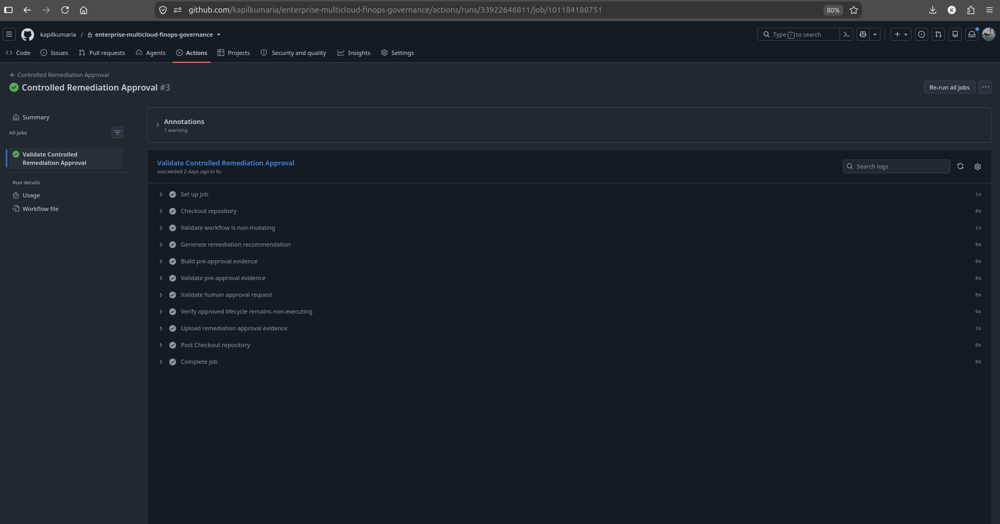
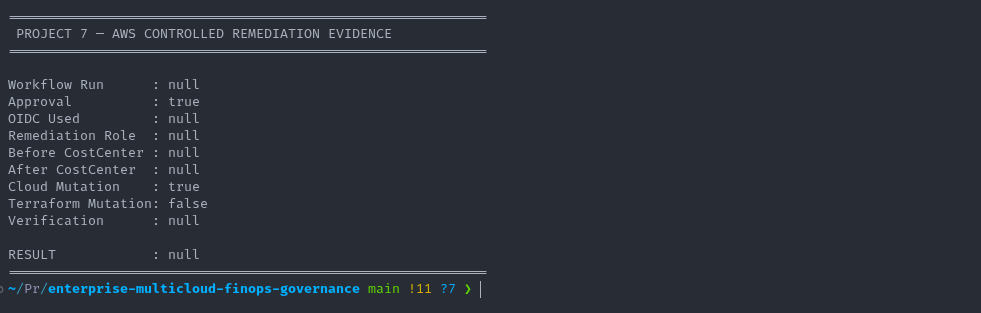
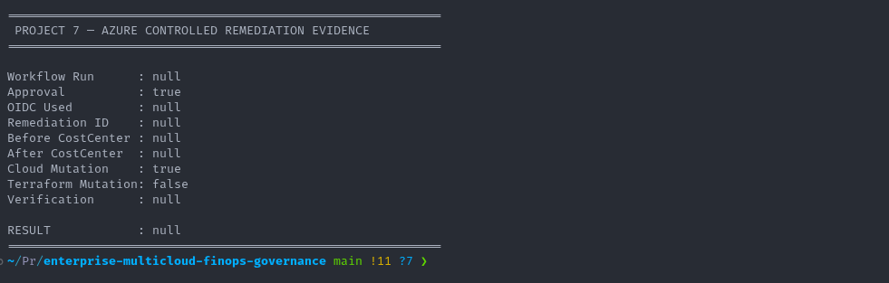
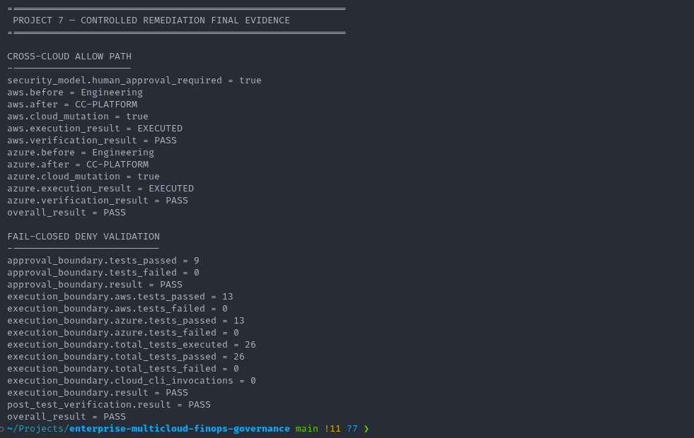

# Controlled Remediation

## 1. Overview

This document explains the controlled-remediation capability implemented by the Enterprise Multi-Cloud FinOps, Governance & Controlled Remediation Platform.

The remediation subsystem demonstrates how a governance finding can be converted into a tightly controlled cloud mutation without allowing unrestricted automation.

The implementation is intentionally human-approved, narrowly scoped, fail-closed, and reconciled back through Terraform.

The lifecycle is:

```text
Governance Finding
        |
        v
Remediation Recommendation
        |
        v
Policy Validation
        |
        v
Human Approval
        |
        v
Approval Validation
        |
        v
OIDC Authentication
        |
        v
Dedicated Remediation Identity
        |
        v
Before-State Verification
        |
        v
Restricted Cloud Mutation
        |
        v
Post-Change Verification
        |
        v
Terraform Drift Detection
        |
        v
Terraform Reconciliation
        |
        v
Final Zero Drift
        |
        v
Evidence
```
The platform does not implement unrestricted self-healing.

---

## 2. Remediation Objectives

The remediation implementation was designed to:

- convert supported findings into structured recommendations;
- restrict remediation to allow-listed actions;
- require explicit human approval;
- validate approval integrity;
- use short-lived OIDC authentication;
- use dedicated remediation identities;
- verify live state before mutation;
- restrict cloud changes to a narrow scope;
- verify live state after mutation;
- detect resulting Terraform drift;
- reconcile through Terraform;
- prove DENY behavior for invalid requests;
- generate machine-readable evidence.

---

## 3. Why Controlled Remediation

Automated remediation can reduce operational effort, but unrestricted mutation introduces significant risk.

Examples of dangerous remediation behavior include:

- modifying the wrong resource;
- changing an unsupported attribute;
- applying stale approval;
- executing without human authorization;
- using broad administrative permissions;
- silently creating drift from Terraform;
- replaying previously approved requests;
- applying an incorrect desired value.

The project therefore uses controlled remediation rather than autonomous self-healing.

---

## 4. Remediation Architecture

The controlled-remediation architecture separates several trust boundaries.

```text
Finding
   |
   v
Recommendation Engine
   |
   v
Remediation Policy
   |
   v
Human Approval
   |
   v
Approval Validator
   |
   v
GitHub Actions
   |
   v
GitHub OIDC
   |
   +----------------------+
   |                      |
   v                      v
AWS Remediation      Azure Remediation
IAM Role             Identity
   |                      |
   v                      v
Restricted AWS       Restricted Azure
Mutation             Mutation
```
No single component has authority to move directly from detection to unrestricted cloud mutation.

---

## 5. Remediation Components

The remediation implementation is located under:

`scripts/remediation/`

Key components include:

- `generate-remediation-recommendation.sh`;
- `validate-remediation-policy.sh`;
- `validate-remediation-evidence.sh`;
- `validate-remediation-approval.sh`;
- `execute-aws-tag-remediation.sh`;
- `execute-azure-tag-remediation.sh`;
- `build-remediation-evidence.sh`;
- `remediation-policy.json`.

Each script has a distinct responsibility.

---

## 6. Remediation Policy

The remediation policy is maintained in:

`scripts/remediation/remediation-policy.json`

The policy defines the supported action boundary.

The permitted action is:

`set-tag`

The governed tag is:

`CostCenter`

This creates a narrow allow-list.

The remediation engine is not designed to perform arbitrary cloud-resource changes.

---

## 7. Supported Remediation Use Case

The implemented use case focuses on incorrect CostCenter metadata.

The validated transition was:

`Engineering` -> `CC-PLATFORM`

This use case was selected because it demonstrates practical FinOps governance while keeping the mutation boundary narrow and auditable.

---

## 8. Governance Finding

A governance finding represents a detected condition requiring review.

The finding contains enough context to describe:

- cloud;
- target resource;
- policy;
- current value;
- expected value;
- remediation eligibility.

A finding alone does not authorize execution.

It is only input to the recommendation engine.

---

## 9. Example Violation Fixtures

The repository contains remediation-related violation fixtures.

AWS:

`examples/violations/remediation/aws-missing-costcenter.json`

Azure:

`examples/violations/remediation/azure-missing-costcenter.json`

These fixtures allow remediation behavior to be tested predictably.

---

## 10. Compliant Remediation Fixture

A compliant example is maintained under:

`examples/compliant/remediation/aws-costcenter-compliant.json`

This provides a known-good reference for remediation-related validation.

---

## 11. Recommendation Generation

Recommendations are generated using:

`scripts/remediation/generate-remediation-recommendation.sh`

The recommendation engine evaluates whether the finding can be remediated under the configured policy.

Validation includes:

- supported cloud;
- supported finding type;
- supported action;
- approved tag key;
- approved desired value;
- policy compatibility.

If the finding is unsupported, the recommendation process fails.

---

## 12. Recommendation Output

A successful recommendation contains structured information describing the proposed change.

Conceptually:

```text
Cloud
Resource
Current Value
Desired Value
Action
Tag Key
Remediation ID
Requires Approval
```
The recommendation records what could be done.

It does not authorize the cloud mutation.

---

## 13. Recommendation Is Not Approval

The architecture intentionally separates recommendation from authorization.

The flow is:

```text
Finding
   |
   v
Recommendation
   |
   v
Requires Approval
```
A recommendation does not immediately trigger cloud execution.

This prevents the detection system from automatically becoming a privileged remediation engine.

---

## 14. Remediation Policy Validation

The remediation request is checked against the allow-list.

Validation confirms that:

- the action is supported;
- the tag key is supported;
- the desired value is allowed;
- the cloud is supported;
- the evidence is structurally valid.

Any unsupported request must fail before authentication or cloud mutation.

---

## 15. Human Approval



*Successful human-approval validation before controlled remediation execution is permitted.*

Human approval is mandatory.

The project uses an explicit confirmation token.

The required format is:

`APPROVE:<remediation-id>`

This binds the approval to a specific remediation identifier.

The use of a structured token is safer than accepting an unstructured confirmation such as:

`yes`

---

## 16. Why Exact Approval Tokens

An exact token provides several benefits:

binds approval to one remediation request;
reduces ambiguity;
supports automated validation;
reduces accidental authorization;
makes audit evidence clearer.

The approval token must match the remediation being executed.

---

## 17. Approval Validation

Approval validation is implemented using:

scripts/remediation/validate-remediation-approval.sh

The validator checks attributes such as:

remediation ID;
cloud;
target resource;
action;
tag key;
before-state value;
desired value;
approval token;
recommendation result;
approval requirement;
execution status;
authentication status before approval.

If any required condition is inconsistent, the request is denied.

---

## 18. Fail-Closed Approval

The approval validator follows a fail-closed model.

The expected behavior is:

```text
Valid and Consistent Request
        |
        v
ALLOW

Invalid or Unverifiable Request
        |
        v
DENY
```
The system does not attempt to infer intent when approval evidence is incomplete or inconsistent.

---

## 19. Pre-Approval Safety Boundary

Cloud mutation must not occur before approval.

The remediation evidence model verifies that:

- execution was not attempted before approval;
- cloud OIDC authentication was not used as evidence of unauthorized pre-approval execution;
- approval is required before the mutation stage.

This separates recommendation and execution clearly.

---

## 20. GitHub Actions Remediation Workflows

The repository contains dedicated remediation workflows.

Key workflows include:

- Controlled Remediation Approval;
- AWS Controlled Remediation;
- Azure Controlled Remediation;
- AWS Remediation OIDC Validation;
- Azure Remediation OIDC Validation.

The workflows are separated by responsibility to reduce permission scope and improve auditability.

---

## 21. OIDC Authentication

After approval succeeds, remediation workflows authenticate using GitHub OIDC.

The flow is:

```text
GitHub Actions
      |
      v
GitHub OIDC Token
      |
      v
Dedicated Cloud Remediation Identity
      |
      v
Short-Lived Authorization
```
The workflows do not depend on long-lived AWS access keys or Azure client secrets.

---

## 22. AWS Remediation Identity

AWS uses a dedicated remediation IAM role.

This identity is separate from the deployment-oriented IAM role.

The remediation role exists specifically for controlled mutation.

This reduces the blast radius of the remediation workflow.

---

## 23. Azure Remediation Identity

Azure uses a dedicated remediation federated identity.

This identity is separate from the deployment identity.

Azure RBAC is scoped to the governed resource and required tagging permissions.

This follows least-privilege principles.

---

## 24. Before-State Verification

Before executing mutation, the executor checks the current live resource state.

For the validated use case, the expected before-state was:

`CostCenter = Engineering`

The executor verifies that the live resource still matches the approved evidence.

If the state has changed unexpectedly, execution should fail.

---

## 25. Why Before-State Verification Matters

Before-state verification helps protect against time-of-check/time-of-use problems.

For example:

```text
Approval Time:
CostCenter = Engineering

Execution Time:
CostCenter = SomethingElse
```
Without verification, the workflow could execute an approval against a state that no longer matches the original request.

The project prevents that behavior.

---

## 26. AWS Controlled Mutation

AWS remediation uses:

`aws ec2 create-tags`

The permitted mutation is restricted to:

`CostCenter`

The validated transition was:

`Engineering` -> `CC-PLATFORM`

The workflow is not designed to change arbitrary EC2 configuration.

---

## 27. Azure Controlled Mutation

Azure remediation uses:

`az tag update`

The permitted mutation is similarly restricted to:

`CostCenter`

The validated transition was:

`Engineering` -> `CC-PLATFORM`

The workflow does not use general-purpose infrastructure mutation.

---

## 28. Mutation Boundary

The remediation subsystem does not permit arbitrary actions.

Examples of operations intentionally outside the allowed boundary include:

- arbitrary resource modification;
- arbitrary tag keys;
- arbitrary desired values;
- resource deletion;
- resource creation;
- Terraform apply from the remediation workflow;
- Terraform destroy;
- Terraform import.

This keeps remediation scope narrow.

---

## 29. Post-Change Verification

After the cloud API mutation, the executor re-queries the live resource.

The expected lifecycle is:

```text
Approved State
      |
      v
Cloud Mutation
      |
      v
Read Live State
      |
      v
Verify Desired Value
```
A successful API response is not treated as sufficient evidence.

The live state must match the expected result.

---

## 30. AWS Remediation Validation

The AWS controlled-remediation lifecycle was executed successfully.

The validated state transition was:

`Engineering` -> `CC-PLATFORM`

The workflow used:

- GitHub OIDC;
- dedicated AWS remediation IAM role;
- controlled create-tags mutation;
- before-state verification;
- post-change verification.

The final execution evidence recorded:

`PASS`

---

## 31. Azure Remediation Validation

The Azure controlled-remediation lifecycle was also executed successfully.

The validated state transition was:

`Engineering` -> `CC-PLATFORM`

The workflow used:

- GitHub OIDC;
- dedicated Azure remediation identity;
- restricted `az tag update`;
- before-state verification;
- post-change verification.

The final execution evidence recorded:

`PASS`

---

## 32. Terraform Drift After Remediation

The `CostCenter` tag is managed by Terraform.

Therefore, the controlled out-of-band mutation intentionally creates Terraform drift.

The state becomes:

```text
Terraform desired state:
CostCenter = Engineering

Live cloud state:
CostCenter = CC-PLATFORM
```
Terraform correctly detects this difference.

---

## 33. Why Drift Is Expected

The remediation system is not the authoritative infrastructure-management system.

Terraform remains authoritative.

Therefore, an out-of-band remediation to a Terraform-managed property should become visible as drift.

This is expected and desirable behavior.

---

## 34. Terraform Drift Detection

After remediation, Terraform planning was used to detect the changed tag.

The plan reported the difference between:

`Engineering`

and:

`CC-PLATFORM`

This proved that Terraform remained aware of the external mutation.

---

## 35. Terraform Reconciliation

After drift was detected, Terraform was used to restore the declared Infrastructure-as-Code value.

The lifecycle was:

```text
Terraform Desired State
        |
        v
Engineering
        |
        v
Approved Remediation
        |
        v
CC-PLATFORM
        |
        v
Terraform Detects Drift
        |
        v
Terraform Reconciliation
        |
        v
Engineering
```
Both AWS and Azure were validated through this lifecycle.

---

## 36. Final Zero Drift

After reconciliation, Terraform was run again.

The final result showed:

`zero drift`

This demonstrated that the environment had returned to its authoritative Infrastructure-as-Code state.

---

## 37. Terraform Authority Principle

The project explicitly preserves Terraform authority.

Controlled remediation may temporarily change runtime state, but the long-term source of truth remains:

`Terraform`

This avoids the anti-pattern of having two independent automation systems silently competing to manage the same infrastructure properties.

---

## 38. Remediation DENY Architecture

The system was designed to prove DENY behavior as strongly as ALLOW behavior.

The negative path is:

```text
Invalid Request
      |
      v
Validation
      |
      v
DENY
      |
      v
No OIDC Mutation Path
      |
      v
No Cloud Mutation
```
The system must not continue when validation fails.

---

## 39. DENY Test Categories

DENY testing covered approval and execution failures.

Examples of failure classes include:

- invalid confirmation token;
- mismatched remediation ID;
- unsupported action;
- invalid cloud;
- invalid resource;
- wrong tag key;
- invalid desired value;
- mismatched before-state;
- inconsistent evidence;
- replayed or already executed evidence;
- tampered request data.

---

## 40. Approval DENY Tests

Approval-path negative testing completed:

`9 / 9 PASS`

The expected outcome for every case was:

`DENY`

This verified that invalid approval evidence could not progress into execution.

---

## 41. Execution DENY Tests

Execution negative-path validation covered both clouds.

AWS execution DENY tests completed:

`13 / 13 PASS`

Azure execution DENY tests completed:

`13 / 13 PASS`

Combined execution DENY tests:

`26 / 26 PASS`

---

## 42. Combined DENY Validation

The full remediation DENY suite completed:

`35 / 35 PASS`

This combines:

- `9 / 9` approval-path tests;
- `26 / 26` execution-path tests.

The result demonstrates fail-closed behavior across the remediation subsystem.

---

## 43. No Mutation During DENY Tests

A critical validation requirement was proving that rejected remediation requests did not reach cloud mutation.

The DENY suite verified that cloud mutation invocations remained:

`0`

This is stronger evidence than merely checking an error message.

---

## 44. Resource State During DENY Tests

The cloud resources remained unchanged during DENY testing.

The expected `CostCenter` value remained:

`Engineering`

This proved that invalid requests did not modify the governed resources.

---

## 45. Remediation Evidence

Machine-readable remediation evidence is stored under:

`reports/remediation/`

The repository contains:

- AWS execution evidence;
- Azure execution evidence;
- cross-cloud remediation summary;
- DENY-test summary;
- remediation documentation.

---

## 46. AWS Execution Evidence



*Sanitized AWS execution evidence showing the approved CostCenter-only mutation and successful post-remediation verification.*

AWS remediation evidence is stored at:

`reports/remediation/aws/execution-evidence.json`

The evidence records the controlled-remediation lifecycle and verified execution result.

It provides portfolio-safe proof that the AWS remediation path was successfully exercised.

---

## 47. Azure Execution Evidence



*Sanitized Azure execution evidence showing the approved CostCenter-only mutation and successful post-remediation verification.*

Azure remediation evidence is stored at:

`reports/remediation/azure/execution-evidence.json`

This records the Azure controlled-remediation lifecycle.

The evidence demonstrates successful use of the Azure remediation path.

---

## 48. Cross-Cloud Remediation Summary

Cross-cloud remediation evidence is stored at:

`reports/remediation/cross-cloud-remediation-summary.json`

This provides a centralized summary of AWS and Azure remediation outcomes.

It demonstrates that the same governance principles were implemented across both clouds.

---

## 49. DENY Evidence



*Fail-closed validation demonstrating 35/35 DENY tests passed with zero unauthorized cloud mutations.*

DENY-path evidence is stored at:

`reports/remediation/deny-test-summary.json`

This captures the negative-path validation.

The evidence demonstrates:

- expected denials;
- no unauthorized cloud mutation;
- unchanged governed resource state.

---

## 50. Evidence Generation

Remediation evidence is built using:

`scripts/remediation/build-remediation-evidence.sh`

Evidence is treated as part of the implementation rather than an afterthought.

This makes the remediation lifecycle observable and reviewable.

---

## 51. Evidence Sanitization

Raw cloud execution data can contain sensitive identifiers.

Examples include:

- AWS account identifiers;
- Azure subscription identifiers;
- tenant identifiers;
- resource identifiers;
- IAM ARNs;
- user identities.

Curated remediation evidence is sanitized before public Git publication.

---

## 52. ALLOW and DENY Evidence

A mature remediation implementation must prove both paths.

The project therefore preserves evidence for:

- successful AWS remediation;
- successful Azure remediation;
- rejected approval attempts;
- rejected execution attempts.

This provides a more complete security story than documenting only the successful path.

---

## 53. Remediation Security Principles

The remediation implementation follows several security principles.

### 53.1 Detection Is Not Authorization

A governance finding does not automatically authorize cloud mutation.

### 53.2 Recommendation Is Not Execution

The recommendation engine produces a proposal, not a cloud change.

### 53.3 Human Approval Is Mandatory

Execution requires explicit confirmation.

### 53.4 Approval Is Bound to a Remediation ID

The confirmation token includes the remediation identifier.

### 53.5 OIDC Uses Short-Lived Authentication

Long-lived cloud credentials are not required.

### 53.6 Remediation Identities Are Dedicated

Deployment and remediation permissions are separated.

### 53.7 Mutation Is Allow-Listed

Only supported actions and fields may be changed.

### 53.8 Live State Is Verified

The executor verifies before-state and post-change state.

### 53.9 Invalid Requests Fail Closed

Unverifiable requests are denied.

### 53.10 Terraform Remains Authoritative

Out-of-band mutation is reconciled through Infrastructure as Code.

---

## 54. Operational Remediation Lifecycle

The end-to-end operational model is:

```text
DETECT
  |
  v
RECOMMEND
  |
  v
VALIDATE POLICY
  |
  v
REQUEST APPROVAL
  |
  v
VALIDATE APPROVAL
  |
  v
AUTHENTICATE
  |
  v
VERIFY BEFORE STATE
  |
  v
MUTATE
  |
  v
VERIFY AFTER STATE
  |
  v
DETECT DRIFT
  |
  v
RECONCILE
  |
  v
PROVE
```
This lifecycle provides a controlled bridge between governance detection and cloud mutation.

---

## 55. What the Remediation System Does Not Do

The project intentionally does not implement autonomous broad self-healing.

The remediation subsystem does not:

- automatically apply every finding;
- perform unrestricted cloud API operations;
- execute Terraform apply without review;
- destroy resources;
- import unmanaged resources;
- mutate arbitrary tags;
- change arbitrary desired values;
- bypass human approval;
- ignore unexpected before-state changes.

These limitations are deliberate safety controls.

---

## 56. Why Human Approval Was Retained

Human approval was retained because the project models enterprise governance rather than uncontrolled automation.

Human review provides an opportunity to validate:

- business intent;
- remediation scope;
- timing;
- expected impact;
- whether the recommendation is still appropriate.

Automation then handles repeatable validation and execution after approval.

---

## 57. Why Terraform Reconciliation Matters

If remediation changed Terraform-managed state permanently without updating Terraform, the environment would have competing sources of truth.

By deliberately detecting and reconciling drift, the platform demonstrates a safer operating model:

- runtime governance can intervene;
- Terraform still owns declared state;
- drift remains visible;
- reconciliation is explicit.

---

## 58. Remediation Auditability

The remediation implementation provides evidence that can answer:

- what finding triggered the process;
- what action was recommended;
- whether approval was required;
- which remediation ID was approved;
- which cloud identity executed the change;
- what state existed before mutation;
- what mutation occurred;
- what state existed afterward;
- whether Terraform detected drift;
- whether Terraform restored authoritative state;
- whether invalid scenarios were denied.

This provides a strong audit trail.

---

## 59. Infrastructure Teardown After Remediation Validation

After remediation, reconciliation, runtime validation, and evidence collection were complete, the AWS and Azure workload environments were destroyed.

The Terraform environment states were confirmed empty after teardown.

This prevented unnecessary cloud cost while preserving remediation evidence and source code.

---

## 60. Remediation Outcome

The completed remediation implementation demonstrates:

- governance finding processing;
- structured recommendation generation;
- allow-listed remediation policy;
- exact human approval;
- fail-closed approval validation;
- GitHub OIDC authentication;
- dedicated AWS remediation IAM role;
- dedicated Azure remediation identity;
- live before-state verification;
- restricted AWS tag mutation;
- restricted Azure tag mutation;
- post-change verification;
- Terraform drift detection;
- Terraform reconciliation;
- final zero drift;
- successful ALLOW paths;
- `35 / 35` DENY-path validation;
- sanitized remediation evidence.

The final lifecycle is:

```text
FIND
  |
  v
RECOMMEND
  |
  v
APPROVE
  |
  v
VALIDATE
  |
  v
AUTHENTICATE
  |
  v
MUTATE
  |
  v
VERIFY
  |
  v
DETECT DRIFT
  |
  v
RECONCILE
  |
  v
AUDIT
```
This demonstrates controlled remediation as a governed operational capability rather than unrestricted self-healing.
