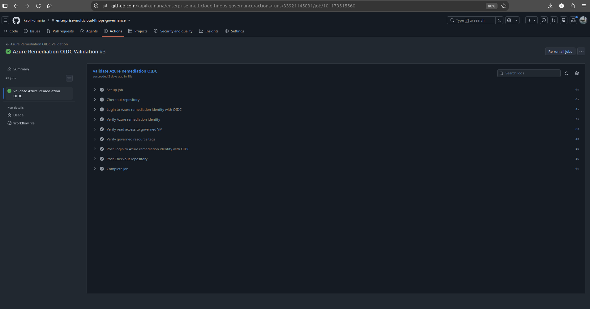

# Security

## 1. Overview

This document explains the security model implemented by the Enterprise Multi-Cloud FinOps, Governance & Controlled Remediation Platform.

The project applies security controls across:

- Infrastructure as Code;
- CI/CD authentication;
- cloud authorization;
- workload configuration;
- network controls;
- logging and encryption;
- governance workflows;
- controlled remediation;
- evidence publication.

The security model is based on several core principles:

- eliminate long-lived CI/CD cloud credentials;
- use short-lived federated identity;
- separate deployment and remediation permissions;
- reduce workload exposure;
- validate infrastructure before deployment;
- restrict remediation to narrow allow-listed mutations;
- require explicit human approval;
- fail closed when authorization cannot be proven;
- preserve Terraform as the authoritative configuration source;
- sanitize public evidence.

---

## 2. Security Objectives

The primary security objectives are:

- prevent static cloud credentials from being stored in GitHub;
- use OpenID Connect federation for CI/CD;
- apply least-privilege cloud authorization;
- separate deployment and remediation identities;
- reduce public network exposure;
- enable logging and encryption;
- harden Azure compute with platform security controls;
- validate Infrastructure as Code before deployment;
- prevent arbitrary automated remediation;
- require explicit approval for cloud mutation;
- verify before-state and post-change state;
- prevent unsafe evidence from being published.

---

## 3. Security Architecture

The security architecture spans multiple trust boundaries.

```text
Engineer
   |
   v
GitHub Repository
   |
   v
GitHub Actions
   |
   v
GitHub OIDC
   |
   +----------------------+
   |                      |
   v                      v
AWS IAM               Azure Federation
   |                      |
   v                      v
AWS Permissions       Azure RBAC
   |                      |
   v                      v
AWS Resources         Azure Resources

Controlled remediation introduces an additional authorization boundary:

Governance Finding
        |
        v
Recommendation
        |
        v
Human Approval
        |
        v
Approval Validation
        |
        v
Dedicated Remediation Identity
        |
        v
Restricted Cloud Mutation
```
---

## 4. GitHub OIDC Authentication



*Successful GitHub Actions OIDC validation demonstrating short-lived federated cloud authentication without static cloud credentials.*

GitHub Actions uses OpenID Connect federation for cloud authentication.

This replaces traditional long-lived cloud credentials.

The authentication flow is:

```text
GitHub Actions
      |
      v
OIDC Token
      |
      v
Cloud Trust Relationship
      |
      v
Short-Lived Credentials
```
The temporary credentials exist only for the workflow execution period.

This significantly reduces the risk associated with stored access keys and client secrets.

---

## 5. Static Credential Elimination

The workflow architecture does not require long-lived AWS access keys.

The workflows do not depend on:

`AWS_ACCESS_KEY_ID`

`AWS_SECRET_ACCESS_KEY`

The Azure workflows also do not require:

`AZURE_CLIENT_SECRET`

Authentication instead relies on GitHub OIDC federation.

This reduces:

- secret rotation requirements;
- credential leakage risk;
- accidental credential publication;
- long-lived credential exposure.

---

## 6. AWS OIDC Trust

AWS GitHub Actions authentication uses an IAM trust relationship with GitHub OIDC.

The trust model is:
```text
GitHub Repository / Workflow
          |
          v
GitHub OIDC Provider
          |
          v
IAM Trust Policy
          |
          v
AWS IAM Role
```
The trust relationship restricts which GitHub repository and branch context may assume the role.

This prevents arbitrary external repositories from using the AWS CI/CD identities.

---

## 7. AWS Identity Separation

AWS uses separate IAM roles for different workflow responsibilities.

The design separates:

- deployment and planning identity;
- remediation identity.

Conceptually:

```text
GitHub OIDC
   |
   +--> Deployment IAM Role
   |
   +--> Remediation IAM Role
```
This separation reduces blast radius.

A workflow that performs remediation does not automatically receive the broader permissions associated with infrastructure planning or deployment.

---

## 8. AWS Deployment Identity

The deployment identity is used for cloud-authenticated planning and validation activities.

Its responsibilities include operations required for:

- Terraform provider access;
- resolved Terraform planning;
- cost-governance workflows;
- infrastructure validation.

The deployment identity is logically separate from remediation execution.

---

## 9. AWS Remediation Identity

The AWS remediation identity is dedicated to controlled remediation.

Its purpose is narrowly scoped.

The permitted mutation class is:

`aws ec2 create-tags`

The remediation implementation only allows the approved `CostCenter` tag mutation.

The workflow is not designed to perform:

- arbitrary EC2 modifications;
- unrestricted IAM changes;
- Terraform apply;
- Terraform destroy;
- Terraform import.

This creates a strong mutation boundary.

---

## 10. Azure Federated Identity

Azure GitHub Actions authentication also uses workload federation.

The trust flow is:
```text
GitHub Actions
      |
      v
GitHub OIDC Token
      |
      v
Microsoft Entra Federation
      |
      v
Azure Identity
      |
      v
Azure RBAC
```
This avoids storing an Azure client secret in GitHub.

---

## 11. Azure Identity Separation

Azure separates:

deployment identity;
remediation identity.

Conceptually:

```text
GitHub OIDC
   |
   +--> Deployment Federated Identity
   |
   +--> Remediation Federated Identity
```

This follows the same least-privilege principle used in AWS.

---

## 12. Azure Remediation Authorization

The Azure remediation identity is scoped to the governed resource and required tagging permissions.

The permitted mutation class is:

`az tag update`

The executor is intentionally restricted to the approved CostCenter tag operation.

The workflow is not designed to perform arbitrary Azure infrastructure changes.

---

## 13. Authentication vs Authorization

The platform treats authentication and authorization as separate concerns.

OIDC answers:

`Who is this workflow?`

AWS IAM or Azure RBAC answers:

`What is this workflow allowed to do?`

A valid OIDC token alone does not grant unrestricted cloud access.

Permissions remain governed by cloud-native authorization policies.

---

## 14. Short-Lived Credentials

OIDC federation provides temporary cloud credentials.

This is more secure than persistent CI/CD secrets because:

- credentials have limited lifetime;
- credentials are generated only when required;
- no permanent cloud secret must be stored;
- revocation is primarily controlled through trust and role configuration.

This reduces credential-management overhead and attack surface.

---

## 15. Least-Privilege Design

Least privilege is applied throughout the project.

Examples include:

- deployment and remediation identities are separated;
- remediation permissions are restricted to approved mutation classes;
- Azure remediation authorization is resource scoped;
- AWS remediation uses a dedicated IAM role;
- workflows receive only the GitHub permissions they require.

The objective is to ensure that compromise of one workflow does not automatically grant unrestricted access to all cloud resources.

---

## 16. GitHub Workflow Permissions

OIDC-enabled workflows require:

`id-token: write`

This permission allows GitHub Actions to request an OIDC token.

It does not itself grant cloud permissions.

Cloud access is still controlled by:

- AWS IAM trust and authorization;
- Microsoft Entra federation;
- Azure RBAC.

The project avoids assigning OIDC token permission to workflows that do not need cloud federation.

---

## 17. Terraform Security Validation

Terraform configuration is validated before cloud mutation.

Validation includes:

- formatting;
- initialization;
- provider resolution;
- configuration validation;
- planning.

This prevents malformed Infrastructure-as-Code configuration from progressing into later governance stages.

---

## 18. Checkov Security Scanning

Checkov provides static Infrastructure-as-Code security scanning.

It is used to identify security and configuration issues that Terraform validation alone does not detect.

The security-validation model is:

```text
Terraform
   |
   +--> Syntax Validation
   |
   +--> Checkov
   |
   +--> Custom Governance

Checkov complements project-specific controls rather than replacing them.
```

---

## 19. AWS Network Security

The AWS environment uses a dedicated compute security group.

The VPC also manages the default security group explicitly.

This avoids relying on unmanaged default network behavior.

The AWS baseline contains:

- VPC;
- public subnet;
- Internet Gateway;
- public route table;
- compute security group.

The workload exposure is further reduced at the EC2 level.

---

## 20. AWS EC2 Public Exposure

The EC2 instance is deployed in a public subnet.

However, the instance is configured with:

`associate_public_ip_address = false`

Therefore:

- the subnet has Internet Gateway routing;
- the EC2 instance receives a private IP;
- the EC2 instance does not receive a public IP.

This reduces direct public exposure while preserving the intentionally simple networking baseline used by the project.

---

## 21. AWS Instance Identity

The EC2 instance uses:

- IAM role;
- IAM instance profile.

This provides AWS-native workload identity.

The instance does not require embedded AWS access keys for IAM-authorized operations.

---

## 22. AWS Metadata Controls

The EC2 implementation includes metadata-service configuration.

This allows the project to explicitly manage instance metadata behavior instead of relying entirely on provider defaults.

Metadata controls are an important security consideration because the EC2 metadata service can expose temporary instance-role credentials to applications running on the instance.

---

## 23. AWS Monitoring

Detailed EC2 monitoring is enabled.

Operational monitoring provides additional visibility into workload behavior and supports troubleshooting and governance.

Monitoring complements network-level VPC Flow Logs.

---

## 24. VPC Flow Logs

The AWS network enables VPC Flow Logs.

The data flow is:

```text
VPC Network Traffic
        |
        v
VPC Flow Logs
        |
        v
CloudWatch Logs
```
Flow logs provide network-level visibility useful for:

- troubleshooting;
- audit review;
- security analysis;
- operational evidence.

---

## 25. AWS Log Encryption

The CloudWatch log group used for VPC Flow Logs is encrypted using KMS.

The logging architecture is:

```text
VPC Flow Logs
      |
      v
CloudWatch Log Group
      |
      v
KMS Encryption
```
A dedicated KMS key is used for this logging path.

This protects stored network-flow evidence.

---

## 26. Azure Network Security

The Azure environment uses:

- Virtual Network;
- compute subnet;
- Network Security Group;
- subnet-to-NSG association.

The Network Security Group provides the primary network-policy boundary for the compute subnet.

The VM itself does not have a public IP.

---

## 27. Azure Default Outbound Access

The Azure compute subnet explicitly configures:

`default_outbound_access_enabled = false`

This prevents dependence on implicit platform-provided outbound connectivity.

The control makes outbound network behavior explicit rather than relying on default behavior.

---

## 28. Azure Private Addressing

The Azure VM uses a private IP address.

No public IP resource is attached to the VM.

This reduces direct Internet exposure.

---

## 29. Azure Secure Boot

The Azure VM enables:

`secure_boot_enabled = true`

Secure Boot helps ensure that the VM boot process uses trusted boot components.

It provides protection against certain classes of boot-level tampering.

---

## 30. Azure vTPM

The Azure VM enables:

`vtpm_enabled = true`

Virtual TPM provides hardware-backed style security capabilities within the supported Azure VM environment.

Together with Secure Boot, this strengthens the VM boot-security posture.

---

## 31. Azure Managed Identity

The Azure VM uses a system-assigned managed identity.

This allows the workload to receive an Azure-native identity without storing credentials in configuration files.

The workload identity is separate from CI/CD identities.

This separation reduces the risk of using pipeline credentials inside runtime workloads.

---

## 32. Governance Security

Security validation is integrated with the governance pipeline.

The governance stack includes:

- Terraform validation;
- Checkov;
- region policy;
- mandatory tag policy;
- cost policy;
- runtime compliance.

Security is therefore evaluated alongside organizational and financial controls.

---

## 33. Region Controls

The approved cloud regions are:

AWS: `us-east-1`;
Azure: `canadacentral`.

Restricting regions can support:

- organizational standardization;
- data residency;
- operational consistency;
- cost predictability;
- security policy enforcement.

Disallowed-region fixtures verify that unsupported regions fail governance.

---

## 34. Mandatory Security Metadata

The mandatory tag set includes:

- `Project`;
- `Environment`;
- `Owner`;
- `CostCenter`;
- `BusinessUnit`;
- `DataClassification`.

The `DataClassification` field provides explicit security context.

Ownership metadata also improves incident response and accountability.

---

## 35. Runtime Compliance Security

The project validates live cloud infrastructure after deployment.

AWS runtime compliance completed:

`15 / 15 PASS`

Azure runtime compliance completed:

`18 / 18 PASS`

The combined result was:

`33 / 33 PASS`

This proves that the deployed infrastructure matched the intended governance and security configuration during final validation.

---

## 36. Controlled Remediation Security Model

Controlled remediation is deliberately isolated from normal infrastructure workflows.

The security model is:
```text
Finding
   |
   v
Recommendation
   |
   v
Policy Validation
   |
   v
Human Approval
   |
   v
Approval Validation
   |
   v
Dedicated Remediation Identity
   |
   v
Restricted Mutation
```
The platform does not automatically mutate cloud resources simply because a finding exists.

---

## 37. Recommendation Is Not Authorization

A remediation recommendation describes a possible action.

It does not authorize execution.

This separation prevents the detection system from automatically becoming a privileged mutation engine.

The recommendation must pass policy and approval validation before execution can begin.

---

## 38. Remediation Allow-List

The remediation policy defines a narrow allowed action.

The supported action is:

`set-tag`

The governed field is:

`CostCenter`

Any request outside the supported mutation model should be rejected.

This reduces the attack surface of remediation automation.

---

## 39. Human Approval

A human approval step is required before remediation execution.

The expected confirmation format is:

`APPROVE:<remediation-id>`

This creates an explicit authorization boundary.

The approval is validated rather than accepted as an unstructured human response.

---

## 40. Approval Integrity Validation

The approval validator checks the remediation request against expected evidence.

Validation covers attributes such as:

- remediation ID;
- cloud;
- target resource;
- action;
- tag key;
- before-state value;
- desired value;
- recommendation;
- execution status;
- confirmation token.

This prevents a valid approval for one remediation from being silently reused for a different operation.

---

## 41. Replay and Tampering Protection

The remediation logic validates whether evidence has already been used or is inconsistent with the requested action.

Requests that appear modified, mismatched, replayed, or otherwise invalid are denied.

The expected behavior is:

`DENY`

This supports fail-closed authorization.

---

## 42. Before-State Verification

Before executing a cloud mutation, the remediation executor verifies the live resource state.

This protects against time-of-check/time-of-use problems.

For example, if the approved remediation expects:

`CostCenter = Engineering`

but the live resource has already changed, the mutation should not blindly continue.

The executor must confirm that the approved before-state still exists.

---

## 43. Restricted AWS Mutation

AWS remediation uses:

`aws ec2 create-tags`

The mutation is restricted to the approved CostCenter operation.

The workflow does not use remediation authority for arbitrary infrastructure changes.

---

## 44. Restricted Azure Mutation

Azure remediation uses:

`az tag update`

The operation is similarly limited to the approved CostCenter mutation.

The Azure executor verifies both before-state and post-change state.

---

## 45. Post-Change Verification

A successful cloud API response is not treated as sufficient proof.

After mutation, the resource is queried again.

The expected post-change value must be confirmed.

The lifecycle is:

```text
Approved Change
      |
      v
Cloud Mutation
      |
      v
Read Live Resource
      |
      v
Verify Expected State
```
This improves execution integrity.

---

## 46. Fail-Closed Remediation

The remediation system is designed to fail closed.

If the platform cannot prove that the request is valid, execution is denied.

The model is:

```text
Unverified Request
        |
        v
Validation Failure
        |
        v
DENY
        |
        v
No Cloud Mutation
```
This principle is more important than maximizing automatic remediation coverage.

---

## 47. DENY-Path Validation

The remediation security model was tested using negative scenarios.

The combined DENY-path validation completed:

`35 / 35 PASS`

The tests confirmed:

- invalid approvals were rejected;
- invalid executions were rejected;
- cloud mutation commands were not invoked;
- cloud resource state remained unchanged.

This provides direct evidence of fail-closed behavior.

---

## 48. Terraform Authority

Terraform remains the authoritative configuration source.

Controlled remediation intentionally changes a Terraform-managed value outside Terraform.

This creates temporary drift.

The lifecycle is:

```text
Terraform Desired State
        |
        v
Cloud State
        |
        v
Approved Out-of-Band Mutation
        |
        v
Drift
        |
        v
Terraform Detects Difference
        |
        v
Terraform Reconciliation
```
The remediation engine therefore does not silently become a competing configuration-management system.

---

## 49. Prohibited Remediation Operations

The remediation architecture does not permit arbitrary Terraform mutation from the remediation workflow.

The remediation workflow is not designed to perform:

- `terraform apply`;
- `terraform destroy`;
- `terraform import`;
- arbitrary resource replacement;
- arbitrary tag modification;
- arbitrary desired-value mutation.

This significantly reduces remediation blast radius.

---

## 50. Evidence Security

Operational evidence can contain sensitive cloud information.

Examples include:

- AWS account identifiers;
- Azure subscription identifiers;
- Azure tenant identifiers;
- IAM ARNs;
- user identities;
- cloud resource identifiers.

The project therefore treats evidence publication as a security boundary.

---

## 51. Raw Operational Evidence

Raw reports may remain local and Git-ignored.

They are useful for:

- troubleshooting;
- validation;
- evidence generation;
- operational review.

They are not automatically safe for public publication.

---

## 52. Curated Public Evidence

Selected evidence is sanitized before being committed.

Curated evidence includes:

- cost summaries;
- compliance evidence;
- remediation summaries;
- DENY-path test summaries.

This provides portfolio evidence without exposing unnecessary cloud identifiers.

---

## 53. Repository Safety Validation

Before curated evidence is committed, the repository is checked for sensitive patterns.

Examples include:

- cloud account identifiers;
- subscription identifiers;
- tenant identifiers;
- user email addresses;
- IAM ARN patterns;
- private keys;
- cloud secrets;
- GitHub tokens.

This helps prevent accidental disclosure.

---

## 54. Secret Management

The project minimizes stored secrets.

Cloud authentication does not use static AWS or Azure secrets.

The primary external service secret used by CI/CD is the Infracost authentication token.

That token remains a GitHub secret and is not committed to the repository.

---

## 55. Security of Cost Evidence

FinOps data is treated as potentially sensitive operational information.

Raw billing information can expose:

- account structure;
- subscription structure;
- internal resource names;
- cost-center information;
- provider identifiers.

The project therefore publishes only curated evidence suitable for the public portfolio.

---

## 56. Security of Compliance Evidence

Runtime compliance reports can contain cloud resource identifiers.

The public evidence copies are sanitized.

This allows the repository to demonstrate real runtime governance without exposing unnecessary operational metadata.

---

## 57. Security Validation Before Teardown

Before workload teardown, the project validated:

- Terraform state consistency;
- zero drift;
- runtime compliance;
- OIDC authentication;
- workflow permissions;
- remediation ALLOW behavior;
- remediation DENY behavior;
- evidence sanitization.

This ensured that the security model had been operationally demonstrated before infrastructure was removed.

---

## 58. Workload Teardown

After evidence collection and final validation, AWS and Azure workload infrastructure was destroyed.

This reduces:

- unnecessary cost;
- unnecessary Internet-accessible attack surface;
- unused cloud-resource exposure.

The Terraform environment states were confirmed empty after teardown.

---

## 59. Security Design Principles

The project follows several security principles.

### 59.1 Eliminate Long-Lived Cloud Secrets

GitHub OIDC replaces persistent AWS keys and Azure client secrets.

### 59.2 Apply Least Privilege

Cloud identities receive only the permissions needed for their responsibility.

### 59.3 Separate Duties

Deployment and remediation identities are independent.

### 59.4 Reduce Public Exposure

AWS and Azure workloads use private addressing without public IPs.

### 59.5 Encrypt Operational Logs

AWS VPC Flow Logs are stored in KMS-encrypted CloudWatch Logs.

### 59.6 Harden Compute

Azure VM security includes Secure Boot and vTPM.

### 59.7 Require Human Approval

Cloud remediation does not execute autonomously.

### 59.8 Fail Closed

Invalid or unverifiable remediation requests are denied.

### 59.9 Verify State Before and After Mutation

Remediation validates live resource state around the cloud change.

### 59.10 Preserve Terraform Authority

Out-of-band mutation is reconciled through Infrastructure as Code.

### 59.11 Sanitize Public Evidence

Operational data is reviewed before publication.

---

## 60. Security Outcome

The completed security implementation combines:

- GitHub OIDC;
- AWS IAM;
- Microsoft Entra federation;
- Azure RBAC;
- identity separation;
- least privilege;
- Checkov;
- Terraform validation;
- private workload addressing;
- VPC Flow Logs;
- KMS encryption;
- Azure Secure Boot;
- Azure vTPM;
- managed identities;
- human-approved remediation;
- fail-closed validation;
- before-state verification;
- post-change verification;
- Terraform drift reconciliation;
- sanitized evidence publication.

The resulting security lifecycle is:

```text
IDENTIFY
   |
   v
AUTHENTICATE
   |
   v
AUTHORIZE
   |
   v
VALIDATE
   |
   v
LIMIT
   |
   v
VERIFY
   |
   v
REMEDIATE
   |
   v
RECONCILE
   |
   v
AUDIT
```
This demonstrates security as an integrated property of the platform rather than a separate post-deployment activity.
